# ORBIT look C: the car screens as built

These pictures are drawn by the unit tests (Robolectric, `captureToImage`) at 1280x720, with sample
data. The map behind is a plain colour: in the car, Waze draws the real map there. Nothing here has
been tried in the car yet.

## 1. Home with music

Navigating at night: the turn top left, speed and time left bottom left, the song's art in its ring bottom right with the time as a badge on top. `OrbitHomeTest.home1280x720Night`.

## 2. Home with no music

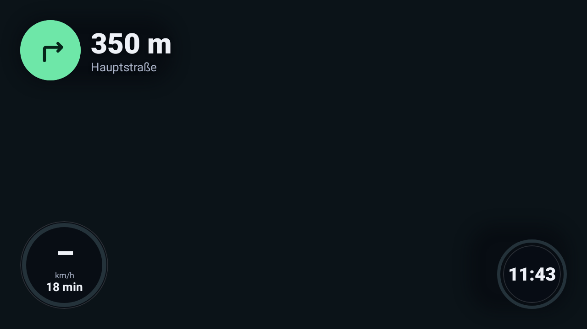

The same home with nothing playing: the empty ring shows the time in its middle instead of a badge. `OrbitHomeTest.homeNothingPlayingNight`.

## 3. Home with ice and a low battery

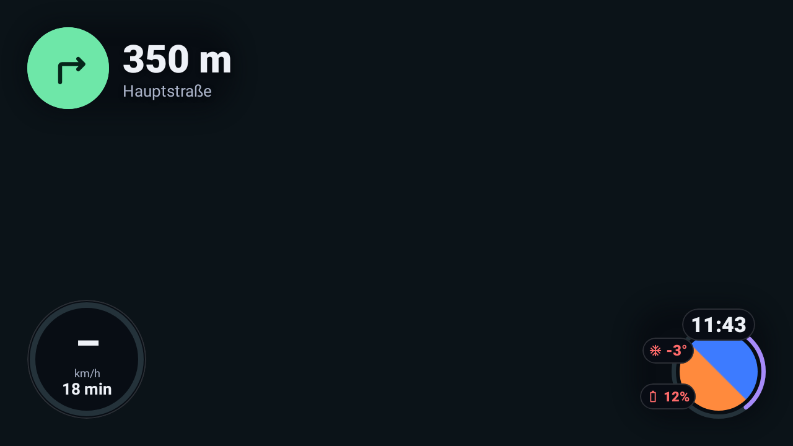

Ice on the road (-3° with the ice sign) and the phone battery at 12 %, both as red pills at the left of the song's ring. The test gives Robolectric a battery level and a car temperature reading, since it has neither. `OrbitHomeTest.homeIceAndLowBatteryNight`.

## 4. The dial

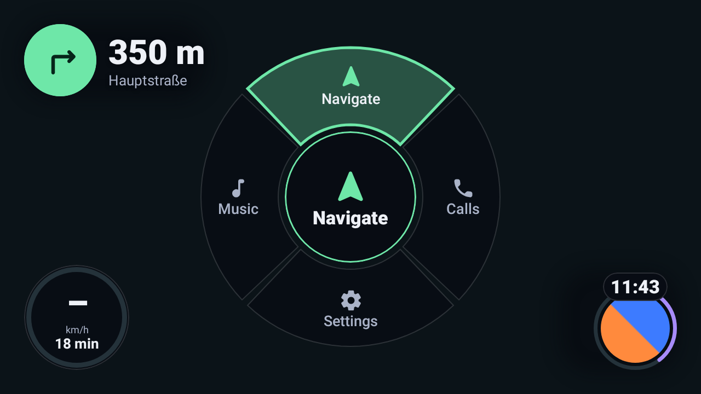

The dial open over the home: Navigate at the top (ringed), Music left, Calls right, Settings at the bottom. `OrbitHomeTest.dialNight`.

## 5. The Apps ring

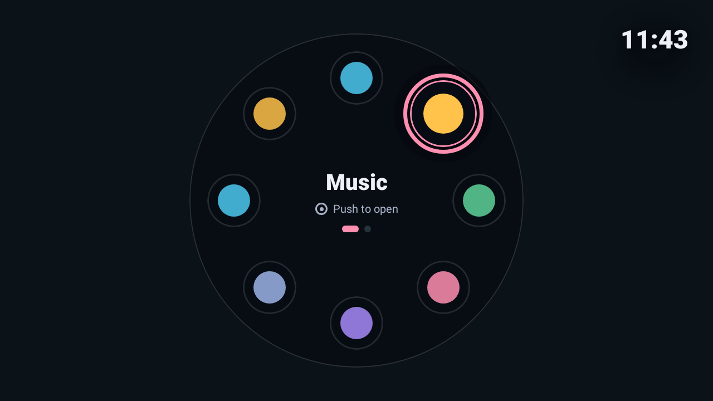

The apps round a ring, one ringed, its name and "Push to open" in the middle, dots for the two pages. The app icons are plain colour dots from the test. `OrbitHomeTest.appsNight`.

## 6. A wheel list

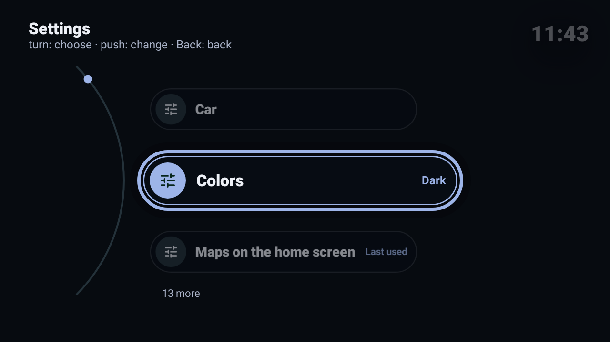

Settings as a list that turns like a wheel: the ringed row big in the middle, one row faded either side, an arc on the left. `OrbitHomeTest.settingsNight`.

## 7. Route preview with Go now

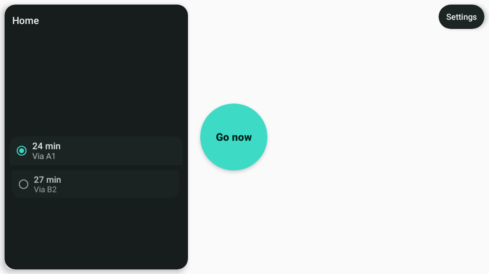

Waze's route choice: the routes on the left, Go now as a big disc beside them. This one is drawn by the template code without the car's map or the ORBIT home around it, so the right side is plain white and it uses the app's day colours. `PrimaryFocusTest.routePreviewPicture`.

## 8. Navigating with lanes

The turn with four lane arrows under the disc: the two lanes to take in green, the others dimmed. `OrbitHomeTest.navigatingWithLanesNight`.

## 9. The actions wheel

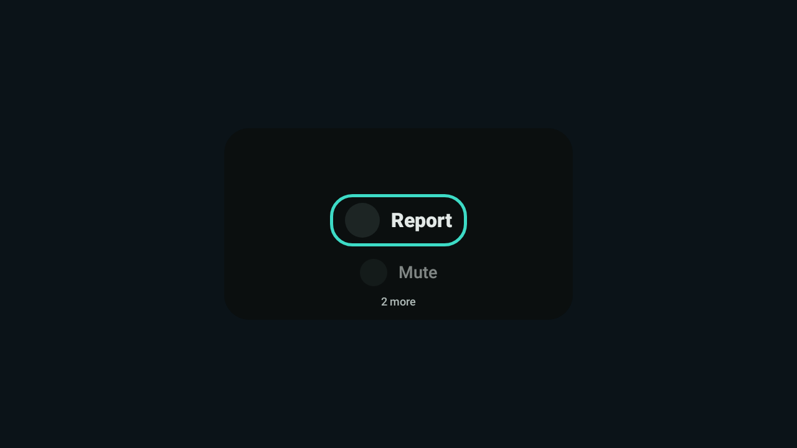

Waze's buttons (here "Report" and "Mute", then Move map and MyPlay home) as a wheel after a push on the map, the first ringed. The icon circles are empty because the test's sample buttons have no icons. `ActionsWheelTest.theOpenWheelPicture`.

## 10. An alert with its countdown

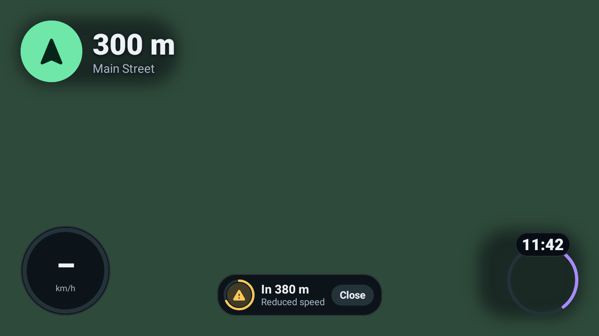

A Waze alert ("In 380 m, Reduced speed", Close) as a small pill at the bottom; the yellow ring round its icon empties as its time runs out (here about a third gone). `MyPlayAlertTest.orbitsTimedAlertPicture`.

## 11. The letter ring

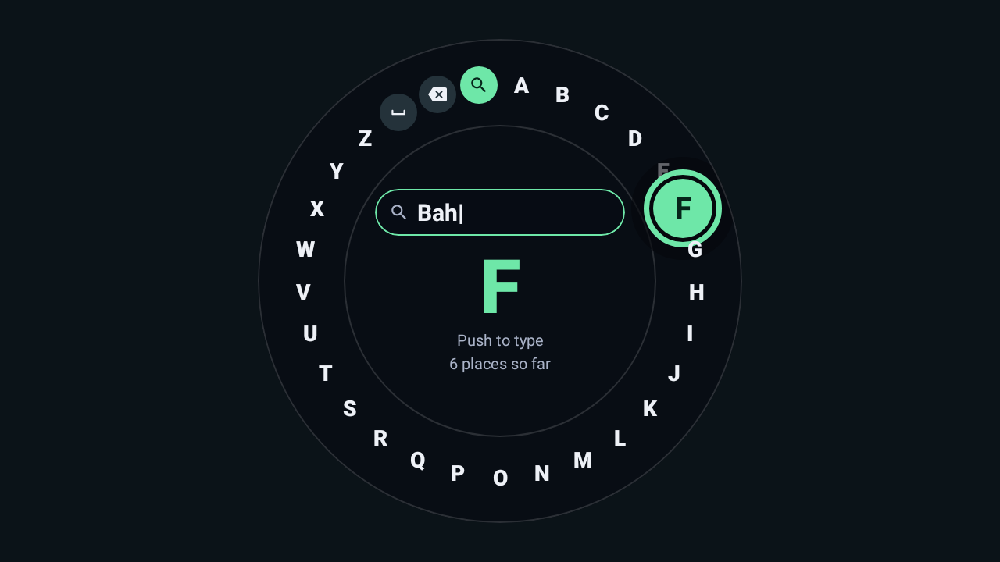

Search typed on a ring of letters: "Bah" typed, the knob on F, "6 places so far". The big F ring covers part of the E next to it. `LetterRingTest.theRingPicture`.

## 12. A notice banner

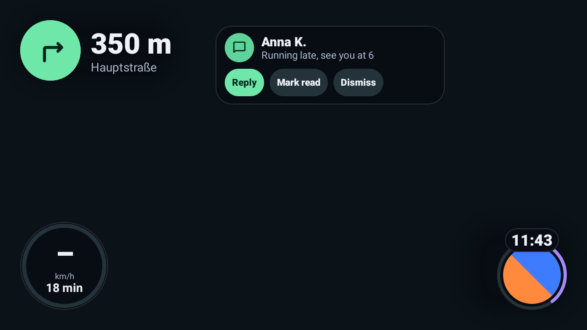

A message from Anna K. at the top middle with Reply, Mark read and Dismiss. `OrbitHomeTest.noticeNight`.

## 13. A ringing call

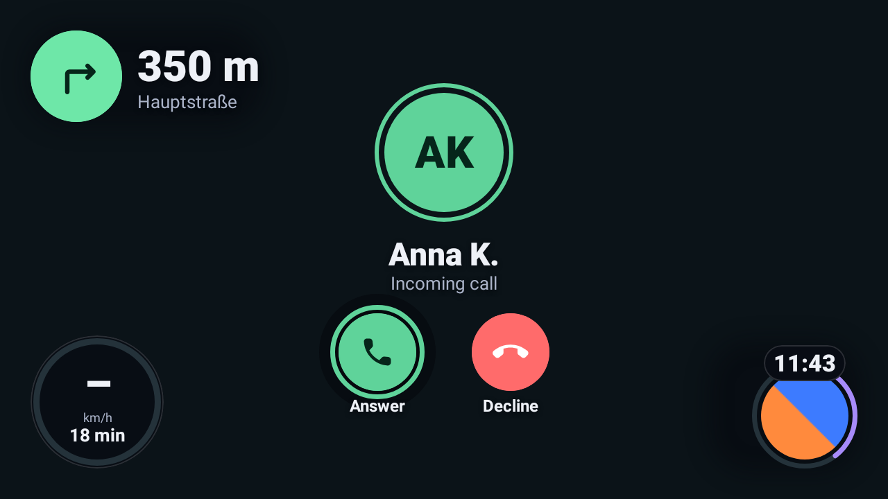

An incoming call: the caller's initials in a green ring, Answer (ringed) and Decline. `OrbitHomeTest.ringingNight`.

## 14. Moving the map

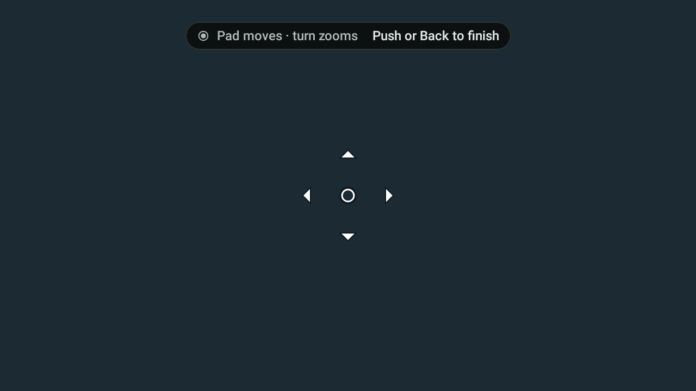

Move mode: the hint pill at the top ("Pad moves, turn zooms; Push or Back to finish") and the crosshair in the middle. `MapMoveStopTest.orbitMoveLookPicture`.

## 15. Day colours

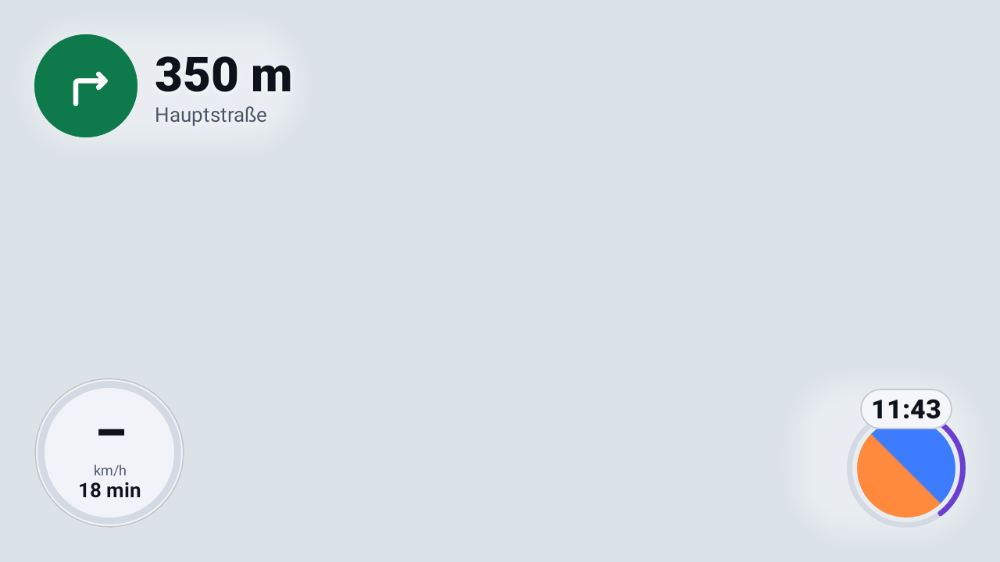

The home with music in day colours. `OrbitHomeTest.home1280x720Day`.
