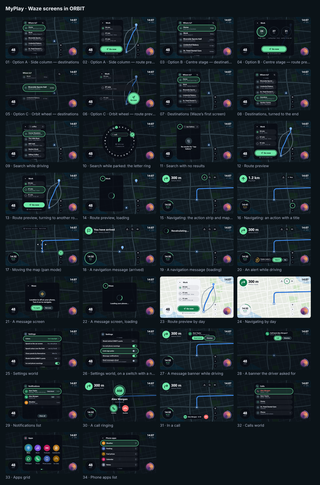

# Waze screens and MyPlay's worlds in ORBIT

Design proposals for every Waze screen the owner meets in the Audi, drawn in ORBIT's language (glass, rings, Navigate's green, the focus ring) at the MMI's 1280 × 720. Waze is a car-app-library app: it sends templates, MyPlay's host (`host/templates`) draws everything except Waze's map surface. These PNGs show how the host's renderers could draw those templates under ORBIT. The owner asked for **one look everywhere**, so MyPlay's own Settings, notices, calls and apps screens (screens 25–34) are drawn in the same style: the same glass, pill rows, buttons, focus ring and corners.

**Sample data only.** Places, times, labels and icons are made up; Waze chooses its own words and icons. The map is a stand-in street map, not Waze's. Each screen uses only fields the template carries (listed below, from the renderers in `host/templates`); words that are not Waze's are MyPlay's own (the knob hints, "Typing works when you're parked", "N more").

## Rules followed

- **Free area** (MC-1): Waze's content stays inside x 288–992, y 43–677. ORBIT's own parts keep their corners: the turn (top left), the clock (top right), the hub with the trip ring (bottom left), the song (bottom right).
- **Knob first**: one obvious focus ring (ORBIT's: 5 px halo gap, 7 px accent, soft halo). The primary action is focused when a screen opens ("Go now", the first place, the first result, an alert's first action, a message's primary action). With nothing to act on, Back is focused.
- **Minimal scrolling**: five rows fit in a list without scrolling; "N more" / "N earlier" say the list goes on. The knob moves the list a row at a time.
- **Glanceable**: titles 27–32 px extra bold, second lines 21 px, numbers bold; ORBIT's night and day glass (accents at least 7:1 by night, 4.9:1 by day).

## Three looks

| | Look | List | Route preview | For | Against |
|---|---|---|---|---|---|
| A | **Side column** (recommended) | [01-option-a-column-list](01-option-a-column-list.png) | [02-option-a-column-route](02-option-a-column-route.png) | A 420 px glass column on the driver's side of the free area; the map stays visible to its right. Waze's routes stay visible beside the choices; the map's visible area (right of the column) is told to Waze, so it fits the routes there. Same column for every screen: one place to look. | Narrower rows: the distance moves to the second line. |
| B | **Centre stage** | [03-option-b-stage-list](03-option-b-stage-list.png) | [04-option-b-stage-route](04-option-b-stage-route.png) | One panel fills the free area. The biggest type; routes as ORBIT rings. | Covers the map: the route preview's routes are hidden. |
| C | **Orbit wheel** | [05-option-c-wheel-list](05-option-c-wheel-list.png) | [06-option-c-wheel-route](06-option-c-wheel-route.png) | Rows on an arc that turns like ORBIT's dial; the focused row is always in the middle and biggest. Most ORBIT-like; no scroll position to think about. | Only three rows at once; "Go now" is a second place to look; more work to build. |

**Recommendation: A, the side column.** It is the only look where the driver can compare routes on the map while choosing, it keeps the map useful behind every list, and it is the smallest change from today's `MapContentCard` (a start-side card, full height), so the host's list, search and route-preview renderers keep their structure and change mostly their drawing.

## Every key screen in look A

| PNG | Screen | Template | Fields drawn | Notes |
|---|---|---|---|---|
| [07-destinations](07-destinations.png) | Destinations (Waze’s first screen) | `MapWithContentTemplate › ListTemplate (or PlaceListNavigationTemplate)` | header: Action.APP_ICON + title · header actionStrip (search) · itemList rows: image, title, texts (address, DistanceSpan), browsable · mapController.mapActionStrip | Opens with the first place focused. Five rows fit with no scrolling; “2 more” shows the list goes on. The distance (Waze’s DistanceSpan) is pulled to the row’s end so it can be read at a glance. |
| [08-destinations-scrolled](08-destinations-scrolled.png) | Destinations, turned to the end | `MapWithContentTemplate › ListTemplate` | itemList (as above) · onItemVisibilityChangedDelegate gets the rows now shown | Turning past the fifth row moves the list a row at a time, the focus stays one row from the edge, and “2 earlier” appears at the top. |
| [09-search-driving](09-search-driving.png) | Search while driving | `SearchTemplate` | headerAction (BACK) · searchHint · initialSearchText · itemList (rows: image, title, texts, DistanceSpan) · isLoading · showKeyboardByDefault (refused while driving) | Typing is refused while driving (as Android Auto), so the field shows the search text Waze sent, with a lock, and the focus goes straight to the first result. |
| [10-search-parked-keyboard](10-search-parked-keyboard.png) | Search while parked: the letter ring | `SearchTemplate (our keyboard)` | searchHint · the text we own (sendSearchTextChanged on each letter, sendSearchSubmitted on Search) · itemList (its size, as you type) | Parked, the knob types on a ring of letters that fills the free area: turn to a letter, push to type it. Space, delete and Search close the ring. The text and the number of places Waze has found so far sit in the middle; Search (or the d-pad down) goes to the results list. |
| [11-search-no-results](11-search-no-results.png) | Search with no results | `SearchTemplate` | itemList empty → itemList.noItemsMessage (else our “No results”) | The message Waze gives for an empty list, centred in the column; the focus falls back to Back so one push leaves. |
| [12-route-preview](12-route-preview.png) | Route preview | `RoutePreviewNavigationTemplate` | header / title + headerAction (BACK) · itemList rows (title = time, texts = via, distance) with onSelectedDelegate + selectedIndex · navigateAction (FLAG_PRIMARY) · actionStrip · mapActionStrip · panModeDelegate | “Go now” holds the focus when the screen opens: one push starts the drive. Turning the knob back moves through the routes (each is a radio row: a push picks it, Waze redraws the map). The map’s visible area is right of the column, so Waze fits the routes there. |
| [13-route-preview-choosing](13-route-preview-choosing.png) | Route preview, turning to another route | `RoutePreviewNavigationTemplate` | itemList (onSelectedDelegate.sendSelected on push) · navigateAction | The focus ring on the second route; the radio dot still on the chosen one. A push picks it and the focus jumps back to “Go now”. |
| [14-route-preview-loading](14-route-preview-loading.png) | Route preview, loading | `RoutePreviewNavigationTemplate` | isLoading · header / title · navigateAction (not drawn until routes come) | Only ORBIT’s spinning ring: Waze sends no words while loading, so we add none. Back is focused. |
| [15-navigating](15-navigating.png) | Navigating: the action strip and map buttons | `NavigationTemplate` | navigationInfo (RoutingInfo → ORBIT’s turn disc and lanes) · destinationTravelEstimate (→ the hub: arrival, time and distance left, remainingTimeColor) · actionStrip (top) · mapActionStrip (right) | ORBIT draws the turn and the trip itself; Waze’s action strip becomes a row of discs along the top of the free area and its map buttons a column down the right edge, both clear of the middle where Waze draws the car. Here the knob is on the first strip action. |
| [16-navigating-titled-strip](16-navigating-titled-strip.png) | Navigating: an action with a title | `NavigationTemplate` | actionStrip with a titled Action (icon + title) · mapActionStrip | When Waze sends an action with words, it becomes a pill in the same row. Here the knob is on the map’s zoom-in disc. |
| [17-navigating-pan](17-navigating-pan.png) | Moving the map (pan mode) | `NavigationTemplate` | mapActionStrip (Action.PAN) · panModeDelegate.sendPanModeChanged · SurfaceCallback onScroll / onScale | Pan mode hides the turn and the action strip (as Android Auto). The pan disc is lit; the d-pad moves the map, turning zooms, Back leaves pan mode. |
| [18-navigating-message](18-navigating-message.png) | A navigation message (arrived) | `NavigationTemplate (navigationInfo = MessageInfo)` | MessageInfo: title, text, image · destinationTravelEstimate (if any) | A MessageInfo takes the turn’s place: its image in the accent disc, its title and text floating beside it like the distance and road. |
| [19-navigating-rerouting](19-navigating-rerouting.png) | A navigation message (loading) | `NavigationTemplate (RoutingInfo.isLoading, or a MessageInfo with no image)` | RoutingInfo.isLoading · or MessageInfo title / text | While Waze works out the way, the turn disc becomes ORBIT’s spinning ring; any words it sends float beside it. |
| [20-alert](20-alert.png) | An alert while driving | `Alert (AppManager.showAlert)` | title · subtitle · icon · actions (first two) · durationMillis (→ the ring round the icon) · callbackDelegate (timeout / cancel) | ORBIT’s alert pill, between the hub and the song, clear of the turn. New: the alert’s time left runs as a ring round its icon, so the driver sees it will go by itself. The first action is focused; Back dismisses. |
| [21-message](21-message.png) | A message screen | `MessageTemplate (alone, or in MapWithContentTemplate)` | header / title + headerAction · icon · message · isLoading · actions (up to two; FLAG_PRIMARY filled) · debugMessage (never shown in the car) | Centred in the free area on glass. The primary action (or the first) is focused; a second action is a plain pill beside it. Back is the header action. |
| [22-message-loading](22-message-loading.png) | A message screen, loading | `MessageTemplate (isLoading)` | isLoading · message (if any) | ORBIT’s ring spinner in place of the icon; no buttons, so Back is focused. |
| [23-route-preview-day](23-route-preview-day.png) | Route preview by day | `RoutePreviewNavigationTemplate` | as Route preview | ORBIT’s day glass and darkened accent (each at least 4.9:1); the same layout. |
| [24-navigating-day](24-navigating-day.png) | Navigating by day | `NavigationTemplate` | as Navigating | The day glass over a day map. |

## MyPlay's own worlds, in the same look

Worlds that have no map to keep in view (Settings, Notifications, Calls, Apps) use the whole free area (x 288–992) in the same glass card as Waze's column. Banners and calls over the map use the alert's pill and buttons. These are MyPlay's own screens, not templates: the fields are the skin's data classes (`ui/car/myplay/MyPlaySkin.kt`, `ui/car/CarModel.kt`), and the setting titles are the real ones from `EngineSettings.kt`.

### Settings

| PNG | Screen | Drawn by | Fields drawn | Notes |
|---|---|---|---|---|
| [25-settings](25-settings.png) | Settings world | `MyPlay · SettingsWorld (SettingsPage)` | SettingRow: title · value (a choice’s label) · switch + on · note | The same pills as Waze’s lists, across the whole free area: a choice shows its value and a chevron (a push steps it on), a switch shows ORBIT’s accent switch. Six rows fit; the first is focused. |
| [26-settings-switch](26-settings-switch.png) | Settings world, on a switch with a note | `MyPlay · SettingsWorld (SettingsPage)` | SettingRow: title · switch + on · note | Turned further down: the focus on a switch; a push flips it. A setting’s note (here: it can only be turned on while stopped) goes under its title. |

### Notices and banners

| PNG | Screen | Drawn by | Fields drawn | Notes |
|---|---|---|---|---|
| [27-notice-message](27-notice-message.png) | A message banner while driving | `MyPlay · Notice (CarNotice, message = true)` | CarNotice: icon · title · text (hidden while driving for a message) · actions (labels) · asked = false → the ring on Dismiss | The same glass and buttons as Waze’s alert, at the top of the free area, 500 px wide so it clears the turn’s distance and the clock. Nobody asked for it, so the focus ring is on Dismiss: a stray push never acts. A message’s text is hidden while driving. |
| [28-notice-asked](28-notice-asked.png) | A banner the driver asked for | `MyPlay · Notice (CarNotice, asked = true)` | CarNotice: icon · title · text · actions · asked = true → the ring on the first action | After “Call back” the driver expects to act: the ring is on the first button, so one push calls. |
| [29-notifications](29-notifications.png) | Notifications list | `MyPlay · NoticeList (NoticeListPage)` | NoticeRow: notice (icon, title) · text · time · action (the label a push runs) · a null notice = Clear all | The same rows: the notice’s app icon, its title, its text, the time at the end and, when it has one, the action a push runs as a small pill. Clear all closes the list. |

### Calls

| PNG | Screen | Drawn by | Fields drawn | Notes |
|---|---|---|---|---|
| [30-call-ringing](30-call-ringing.png) | A call ringing | `MyPlay · Ringing (CarCall, ringing = true)` | CarCall: name · ringing · canEnd → Answer / Decline (CALL_ANSWER, CALL_DECLINE) | Centred in the free area: the caller’s initials in Calls’ green ring, the name, and two big discs. Answer holds the focus; Decline is a turn away. While the driver is navigating the turn and the hub stay. |
| [31-call-in-call](31-call-in-call.png) | In a call | `MyPlay · InCall (CarCall, ringing = false)` | CarCall: name · sinceMs (the time) · canEnd → the red hang-up disc | The call shrinks to a pill at the bottom of the free area, like the alert, so the map comes back. The ring is not on it until the driver turns there; hang-up is red and one turn from the call pill. |
| [32-calls-world](32-calls-world.png) | Calls world | `MyPlay · PhoneWorld (PhonePage)` | PhoneRow: title · subtitle · kind (RECENT, MISSED, FAVOURITE, PHONE_APP — last) · loading · permitted | Recent calls, then favourites, then the phone app, as the same pills. A missed call is in the warning red; the first row is focused so one push calls back. |

### Apps

| PNG | Screen | Drawn by | Fields drawn | Notes |
|---|---|---|---|---|
| [33-apps-grid](33-apps-grid.png) | Apps grid | `MyPlay · AppsWorld (CarAppEntry list, page / pages)` | CarAppEntry: label · icon · kind · ringed tile · page / pages | Round icons in a 4 × 2 grid (8 per page), the label under each; the focused app gets the ring round its icon and a bolder label. The page dots say how many pages there are; turning past the last tile goes to the next page. |
| [34-phone-apps](34-phone-apps.png) | Phone apps list | `MyPlay · AppsWorld, phone apps (CarAppEntry, kind PHONE_SCREEN / STANDALONE)` | CarAppEntry: label · icon · kind | The phone’s own apps that the owner allowed on the car (Apps › Phone apps on the phone), as rows rather than tiles: there can be many, and a name reads quicker than an icon. Each opens on the phone’s mirrored screen. (Assumed: the data is the same CarAppEntry list as the grid.) |

## Placement, in the car's pixels

| Part | Where | Size |
|---|---|---|
| Content column (list, search, route preview) | x 288–708, y 43–677 | 420 × 634, corner 44 |
| Rows | in the column | 84 high (routes 92), pill; image in a 56 disc |
| "Go now" (navigateAction) | column foot | full width × 88, accent fill |
| Action strip (NavigationTemplate) | top of the free area, right-aligned to x 992 | discs 72, gap 14; titled actions as pills |
| Map action strip | down the right edge, x 928–992, bottom at y 677 | discs 64, gap 14 |
| Alert | bottom of the free area, x 288–908, y 556 | pill; icon in an 84 ring that counts down `durationMillis` |
| Message (MessageTemplate) | centred, x 338–942, y 103–617 | 604 × 514 |
| Letter ring (parked search) | centred in the free area | 620 ring |
| World panel (Settings, Notifications, Calls, Apps) | the whole free area, x 288–992, y 43–677 | 704 × 634; rows 76–88 high |
| Notice banner | top of the free area, x 470–970 | 500 wide, clear of the turn's distance and the clock |
| Ringing call | centred in the free area | caller ring 200; Answer / Decline discs 112 |
| In-call pill | bottom of the free area | pill 76 high + red hang-up disc 76 |

## What the host would change

- `MapScaffold`: the action strip and map action strip as ORBIT discs in the free area's top right and right edge (today: top end and bottom end of the whole screen, under ORBIT's clock and song).
- `MapContentCard`: the column above (today 42 % of the width, 320–480 dp) in ORBIT glass; rows as pills with the focus ring.
- `ItemListView` / `RowItem` in a narrow column: the DistanceSpan text first on the second line.
- `RoutePreviewNavigationTemplateView`: focus starts on `navigateAction`; after a route is picked (`onSelectedDelegate`) the focus returns to it.
- `SearchTemplateView`: while driving, focus starts on the first result; parked, the letter ring replaces `CarKeyboard` (same `KeyboardSink`: type, backspace, submit, hide).
- `AlertCard` / ORBIT's `MapAlertCard`: a countdown ring from `durationMillis`.
- `NavigationTemplateView`: `MessageInfo` and `RoutingInfo.isLoading` in ORBIT's turn disc (today a separate card).

## Open questions for the owner

- Phone apps list: drawn from the same `CarAppEntry` list as the grid (phone apps allowed on the car, opened on the mirrored screen). Is that the list meant?
- The letter ring is new: is turning through 29 keys quick enough, or should the d-pad jump by a quarter of the ring?
- Should the column sit on the driver's side (left, as drawn) in every case, or move right when Waze's map needs the left?

## Rebuilding

`node docs/design/waze-screens/src/build.cjs` renders every screen (HTML in `html/`, PNGs here, `overview.png`) with Playwright at 1280 × 720, 1×. Parts are in `src/parts.cjs` (ORBIT's tokens from `OrbitTokens.kt`), screens and sample data in `src/screens.cjs`. Icons are the phone-app design's (`src/icons.json`, Lucide, ISC licence); the font is `../phone-app/src/fonts/RobotoFlex`.
