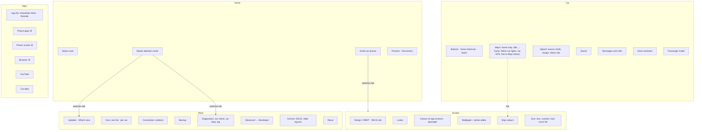

# MyPlay phone app: new information architecture (plan)

Information architect, 2026-11-22. **Revision 4**: aligned with the approved design (`docs/design/phone-app/`, review "Second pass", bfaa662) and a build order added (§16). Revision 3 folded in the owner decisions (§13). Revision 2 followed the independent review
(`docs/plans/phone-app-review.md`, commit b4818e9); §15 answers each of its 24 findings.
A plan only: no app code is changed. Built from reading the code on `claude/myplay`
(`ui/MainActivity.kt`, `ui/MyPlayUpdateCheck.kt`, `ui/phone/*`, `Settings.kt`, `SettingsBackup.kt`,
`MyPlayBackupKeys.kt`, every file that reads or writes the `settings` SharedPreferences, and, for
what ORBIT reads, `host/CarRuntime.kt`, `host/MyPlayWeather.kt` and `ui/car/myplay/**`).
Visual design is **not** part of this plan; a later session does it.

The owner's verdict on today's app: too much text, things are hard to find (updates sit under
Connection), Back loses the place on the main screen, and they want a new app rather than a patch.

The owner's decisions on the five open questions are recorded in §13 and built into this plan.

---

## 1. What is wrong today (from the code)

| Problem | Where in the code | Effect |
|---|---|---|
| **Back resets the main screen's scroll.** | `MainActivity.Home()`: the start screen and each page are two branches of one `AnimatedContent(page)`. Opening a page disposes the start screen's `LazyColumn`, and its list state is not hoisted or saved. | Back always lands at the top of a very long screen. |
| **No real back stack.** | `page` is one `rememberSaveable` value. Bar → "Change the layout" sets `page = LAYOUT`; Back then sets `page = null`. | Back from a page opened from another page skips the page you came from. |
| **Updates are split three ways.** | The **Updates** tile opens **About** (`pageOf(BehindTile.UPDATES) = Page.ABOUT`). The auto-check switch and "Check now" are in **Connection**. The install button is on the start screen under the banner. | You cannot find updates. |
| **The start screen holds everything.** | `CustomiseScreen`: update banner, install button, certificate banner, status card, "Finish setting up", car picture, hint, 9 part pills, then 14 tiles. | Long scroll, no hierarchy. |
| **The same setting in two or three places.** | "Dup" flags in Appendix A (theme, accent, wallpaper, bar side, dark bar, weather, cards, phone screen, maps follow car lights, certificates, notification access). A hidden page (`Page.CAR_SCREEN`) is reachable only by tapping the whole car picture. | Unclear which control is "the" setting. |
| **Too much text.** | 45 strings are over 150 characters; three are over 300 (`cert_hint`, `setup_backup_hint`, `setup_trusted_head_units_hint`). Most rows carry a two-line subtitle; most pages end with one to four `HintLine`s. | Reading instead of doing. |
| **Settings that do nothing on the ORBIT screen are shown as if they did.** | Checked in the code (review findings 1–4). Under ORBIT: **clock, status icons, bar items (`rail_widgets`), bar side (`rail_position`, ORBIT has no app rail: `OrbitSkin.appRail = false`), dark bar, dashboard cards, the "map behind" layout and weather** have no effect. **Theme, accent, your own colours, text size and density do**: `CarRuntime.Root()` wraps the whole car screen, ORBIT included, in `CarTheme(...withAccent...withCustomColours...)` and scales `fontScale` by `car_text_size`; every app ORBIT opens (templates, media, messaging, browser, phone screen) draws in that theme. | The owner tunes things that cannot change what they see. |
| **Weather is fetched while nothing shows it.** | `MyPlayWeather.wanted()` looks only at the older layout kind, not at whether ORBIT is on. | An approximate position goes to Open-Meteo every 30 minutes for no visible result. Code fix needed outside this rebuild (§12). |
| **Car-check results are lost when the page closes.** | `CarCheckPage` keeps results in `remember { mutableStateMapOf() }`. | Leaving the page mid-check loses the run. |
| **Notifications cannot open a page.** | One `PendingIntent` with no extras (`ProjectionService.kt:588`); `onNewIntent` reads only `phone_parts` and the debug `hu_server` extra. | "Download certificate" from a notification lands on the start screen. |
| **Pages copy settings instead of observing them.** | `remember { mutableStateOf(settings.x) }` everywhere, patched by `settingsGeneration` and `rememberSettingsChanges`. | A change from the car, a look or a backup needs a forced rebuild. |
| **Dead code.** | `CategoryRow()` and `Header()` in `MainActivity.kt` are never called; `Page.*.subtitleRes` is read only by `CategoryRow`. | Drop. |

---

## 2. Principles

1. **One home per thing.** Every setting, action and piece of status has exactly one page. Other
   places may show a *link* (a row with the value that opens the home page), never a second control.
2. **Where would the owner look?** Group by task ("change how the car screen looks", "change what a
   button does"), not by how the code is split.
3. **Only what changes the car.** A setting that does nothing under the design in use is not on a
   main page. It lives in Archive with the design it belongs to.
4. **Back always returns to exactly where you were**: same page, same scroll, same open row.
5. **Short words; details on request**, with numeric limits and a test (§9).
6. **Storage never changes.** Same keys, types and defaults; backups keep working unchanged.
7. **One source of truth.** Pages observe settings; they never keep their own copy.

---

## 3. The new structure

### 3.1 Top-level categories

Five destinations in a **bottom bar** (no sixth tab, ever; new features become rows):

| Tab | Holds | Why it is a tab |
|---|---|---|
| **Home** | Connection status, anything that needs attention, a small car screen picture, Preview and Disconnect | The first question is always "is it working, and is anything wrong?" |
| **Screen** | How the car screen **looks**: design (ORBIT), looks, colours of app screens, wallpaper, map colours, size | Where the owner spends most time |
| **Car** | What the car **does**: buttons and knob, maps, speed and limits, sound, messages and calls, voice, passenger mode | Everything that changes behaviour in the car. Named "Car", not "Drive", so Sound and Messages are not a guess (review 13); decided by the owner (§13) |
| **Apps** | The car screen's app list itself: show/hide, order, and each special app (phone apps, phone screen, browser, YouTube, car data) with its ⚙ | Answers "what is on my car screen" in one look; new apps are new rows |
| **More** | Updates, cars, backup, diagnostics, advanced, archive, about | Rare things, each one tap away |

Why a bottom bar rather than today's home with tiles:

- Five fixed doors are learned once; the tab bar shows where you are.
- Each tab keeps its own history, so switching tabs never loses your place: the root fix for Back.
- A badge on a tab is a standard, quiet signal for "needs attention".
- New features land as rows inside a tab, not as new tiles.

**Rule for every tab root:** it lists **every** page of the tab, each with its current value on the
right (§9.3). No "More options" at root level.

### 3.2 The map



The same as a tree (`›` opens a page; `·` separates rows on a page):

```
Home
├─ Status card ............ car name, USB / wireless, Details (video, certificate), last error; Trust
├─ Needs attention ........ cards, only when true (§10); each switches to the page's own tab
├─ Small car picture ...... tap → Screen tab (or the part's page, §3.5)
└─ Preview car screen · Disconnect (when connected)

Screen                      (large car picture at the top; parts tappable)
├─ › Design ............... ORBIT (RACE later) · Panels close after
├─ › Looks ................ built-in · yours · save · open · share   (rules: §6.1)
├─ › Colours .............. App screens: Theme · Accent · Your own colours ›
│                            · Day and night (car's / dark / light)
├─ › Wallpaper ............ none / built-in / photo · › Edit photo
├─ › Map colours .......... preset · sliders · before/after
└─ › Size ................. Text size · Control size · How much fits

Car
├─ › Buttons .............. drawing of wheel + knob → per control: press, hold, double, hold+turn
│                            · Timing · Show what a button did · › ORBIT home: pad shortcuts
│                            · › Teach a car button · Reset this page
├─ › Maps ................. Map on home · Go home when idle · Follow the car's lights
│                            · Use the car's GPS (+ mock-location row) · Map colours › (link)
│                            · [slot: maps apps]
├─ › Speed ................ Speed source · Region · Limits file · Warn when over by
│                            · [slot: Limit from Waze]
├─ › Sound ................ Sound to the car · status (Best / All sound / Music only) · method rows
│                            · Play music when connected
├─ › Messages and calls ... Banners · Group chats · Read aloud · Do not disturb · Auto-reply
│                            · Calls on phone speaker
├─ › Voice assistant ...... same as phone / pick one
└─ Passenger mode (switch + one warning line)

Apps                        (the root IS the car screen's app list)
├─ Phone apps ⚙ ........... (top entry) switch · allowed apps · per app: knob turn · keep awake
├─ Maps / media / messaging apps, each: show/hide switch
├─ Phone screen ⚙, Browser ⚙ (start page), YouTube, Car data (show in the car), Phone, Notifications
├─ Reorder ................ a mode on the same list: handles + up/down buttons
└─ Apps that can't run .... collapsed, read-only

More
├─ › Updates .............. version · Install · Check now · Check automatically · What's new ›
├─ › Cars ................. one list: name, last connected, how, Trusted tag · › a car (Forget)
├─ › Connection ........... Wireless · Phone's Bluetooth address (optional)
├─ › Backup ............... Save · Load · last saved · after-loading list
├─ › Diagnostics .......... › Car check · › Car data (live) · › Connection log
├─ › Advanced ............. Video · Certificates › · Per-car fixes (vehicles.json)
│   └─ › Developer ........ Head unit server (+4) · Map areas · Maps text · Phone parts sample
│                            · link: Detailed protocol log (lives in Connection log)
├─ › Archive .............. › DECK · › Older layouts
└─ › About ................ version · links · thanks · licences · OpenStreetMap notice
```

### 3.3 Routes and ownership

**Every route belongs to exactly one tab.** Names are for the code, search and deep links.

| Tab | Routes |
|---|---|
| Home | `home` |
| Screen | `screen` · `screen/design` · `screen/looks` · `screen/colours` · `screen/colours/own` · `screen/wallpaper` · `screen/wallpaper/edit` · `screen/map-colours` · `screen/size` |
| Car | `car` · `car/buttons` · `car/buttons/pad-shortcuts` · `car/buttons/teach` · `car/maps` · `car/speed` · `car/sound` · `car/messages` · `car/voice` |
| Apps | `apps` · `apps/phone-apps` · `apps/phone-screen` · `apps/browser` |
| More | `more` · `more/updates` · `more/whats-new` · `more/cars` · `more/cars/{car}` · `more/connection` · `more/backup` · `more/diagnostics` · `more/diagnostics/car-check` · `more/diagnostics/car-data` · `more/diagnostics/log` · `more/advanced` · `more/advanced/certificates` · `more/advanced/developer` · `more/archive` · `more/archive/deck` · `more/archive/layouts` · `more/about` |
| (outside tabs) | `setup` (first run, full screen, no bar) |

### 3.4 Navigation and Back

1. **Each tab has its own back stack.** Back pops within the tab. At a tab's root, Back goes to
   Home; at Home, Back leaves the app.
2. **Cross-tab links switch tabs.** A link to a page of another tab (Home cards, the picture,
   search results, notifications, the Maps → Map colours link) **switches to the owning tab and
   pushes the page there**. Back from that page returns **once** to the place the link was tapped
   (tab, page and scroll), then the owning tab behaves normally. The tab bar always highlights
   the tab that owns the page on screen.
3. **Switching tabs** keeps each tab's stack and position.
4. **Tapping the current tab** returns to its root and discards the stack; tapped again at the
   root, it scrolls to the top. Nothing is lost because nothing is ever half-saved (rule 7).
5. **Scroll and open rows** are saved per route and restored on Back, on tab switch, on rotation,
   on the debug `recreate()` and after process death. A search or deep-link target's "scroll to
   row" wins over a restored scroll.
6. **Predictive back** (Android 14+, default from targetSdk 36) is supported for page pops, sheets
   and dialogs. Sheets and dialogs close on Back before the page does.
7. **Text fields save as you type** (auto-reply text, browser start page, Bluetooth address, look
   name drafts), so leaving a page never loses input.
8. **Dialogs that survive rotation:** colour picker, wallpaper editor, backup-load confirm, PKCS#12
   password. Others close.
9. For the builder: Navigation Compose (or equal) with per-tab `saveState`/`restoreState`; no page
   inside a branch that is disposed when another opens; settings **observed** (a prefs listener or
   one flow per key), never copied, so a backup load, a look, or a change made on the car refreshes
   every page without resetting navigation. `settingsGeneration` and the copy-into-`remember`
   pattern go.

### 3.5 Deep links (notifications and the car picture)

- `MainActivity` reads one string extra, **`route`**, in both `onCreate` and `onNewIntent`
  (`singleTask` stays). It switches to the owning tab and pushes the route. An unknown route
  opens Home. The existing `phone_parts` extra and the debug-only adb extra `hu_server` (used by
  `./headunit.sh`) keep working unchanged.
- **Only MyPlay may open a page by route** (review NA-1). `MainActivity` is exported (it is the
  launcher), so the `route` extra counts only when the intent came through the non-exported
  activity-alias `ui.OpenPage`, which only MyPlay's own PendingIntents can target
  (`NextDeepLink.intent`). **No page acts by being opened**: every change needs a tap.
- Each notification gets its own `PendingIntent` **request code** so they don't collapse into one:
  connection status → `home`; Trust → `home` (status card shows Trust); certificate expiring or
  expired, Download certificate → `more/advanced/certificates`; a future update notification →
  `more/updates`.

**The car picture maps per design** (review 5; today `CarPicture.picturePartOf` maps
`OrbitSong` → CARDS and `OrbitTurn` → WHOLE):

| Part tapped | ORBIT | DECK or an older layout |
|---|---|---|
| hub | Screen › Design | Archive › DECK / Older layouts |
| song card | Car › Sound | Archive › Older layouts (cards) |
| turn card | Car › Maps | — |
| speed | Car › Speed | Car › Speed |
| wallpaper | Screen › Wallpaper | Screen › Wallpaper |
| bar, clock, status, dashboard cards | — | Archive › Older layouts |
| apps button | Apps | Apps |
| whole picture | Screen | Screen |

---

## 4. Where status lives

| Status | Primary home | Shown elsewhere |
|---|---|---|
| Connected / connecting / not connected (and why, §10) | Home › Status card | **Nowhere else.** The Home tab is a **house** (Car is a car); the tab has **no connected cue**. Dots on tabs mean "needs attention" only |
| Video, certificate in use, last error | Status card › Details (collapsed) | Diagnostics |
| Trust a new car | Status card (action) | notification |
| Update available | More › Updates | Home card; **badge on More** |
| Setup missing (required items only) | Setup | Home card "Finish setup (N left)" |
| Certificate expiring / expired | More › Advanced › Certificates | Home card |
| Car check in progress / stopped | More › Diagnostics › Car check | Home card |
| Archived design in use | More › Archive | Home card "Using DECK" |
| Every root row's value | its page | the tab root (§9.3) |

**The car-check run** moves out of the page into a process-scoped holder next to `CarInputEvents`.
It survives moving between pages and tabs, not the process being killed; then the Home card says
"Car check stopped — start again".

## 5. Where updates live

**More › Updates** holds everything: this version and "Up to date" or "Version X is ready";
**Install X** (today's `UpdateInstallButton`, progress and errors); **Check now**; **Check
automatically** (`check_updates`, one line: "Once a day, from GitHub"); **What's new ›**.

`check_updates` **keeps its default `false`** (review 7). The owner is asked **once** in Setup, and
once in the first "What's new" after the rebuild for existing installs: "Check for updates
automatically? Once a day, from GitHub." The answer writes the key. Decided by the owner (§13).

Removed: the Updates section from Connection, the tile that opened About, the second install button.

## 6. Advanced, Developer, Archive

**Advanced** (needed once; one line each):
- **Video**: Highest resolution · Prefer 60 fps · Force H.264 · Steady bitrate.
- **Certificates ›**: list · Import · Download · Update automatically.
- **Per-car fixes**: vehicles.json Import / Template;
  Import **asks before replacing** an existing file).

**Developer** (last row of Advanced): head unit server and its four sub-switches (each risky one, "Allow localhost" included, with a warning line: "Any app on this phone can connect") · Show map areas ·
Log maps text · Phone parts sample · a **link** to Detailed protocol log (which lives only in
Diagnostics › Connection log).

**Archive** (keep DECK, "somewhere like archive"). Everything works and is stored as today. Top line:
"Kept as it was. Not updated any more."
- **DECK**: "Use DECK instead of ORBIT" (writes `myplay_engine_language` = `deck`); off → ORBIT.
- **Older layouts**: "Use MyPlay's own screen" (`myplay_engine_preview`; off = older layouts);
  layout kind (taskbar, dock, app grid, map behind); map-behind presets and options; **bar side**;
  **bar items**; **dark bar**; **dashboard cards**; **clock** (size, bold, colour); **status icons**
  (battery icon/number/%, signal, size, colour, by level); **weather** with its privacy line.
- When DECK or an older layout is on, Home shows a quiet card "Using DECK" / "Using an older
  layout" → Archive, and the Screen picture shows that design.

If a later ORBIT draws the clock, status or weather from these settings, those rows move back to
Screen. That is a move of a row, not a restructure.

### 6.1 Looks and archived settings

A look keeps today's keys (`MyPlayLooks.KEYS`, storage and shared files stay compatible): the
archived layout, bar, clock, status and weather keys among them. Since TH-2 (owner report) a look no
longer sets or clears `myplay_engine_language`: choosing one keeps the design in use, and an older
look file that carries it still loads, without it.
Two rules (review 6):
1. Before applying, the look's page lists what it changes, in user words ("Colours, wallpaper,
   map colours"; archived parts summarised as "older-layout settings").
2. A look never changes the **design** (TH-2): DECK is chosen only in More › Archive.

## 7. Search

A **search icon in every tab's top bar** (no second field in More). It searches page titles, setting
labels and synonyms; synonyms are **string resources** (translatable). Settings that only appear
when a parent switch is on are still found: the result opens the parent's page and says "Turn on
X first". A result is a cross-tab link (§3.4 rule 2). The index is built from the route table, so a
new setting is searchable by being registered once.

## 8. Slots for future features

| Feature | Slot |
|---|---|
| RACE | Screen › Design, beside ORBIT; hidden while paused |
| More maps apps | Car › Maps "Maps apps" list; each also a row in Apps |
| Waze speed limit hook | Car › Speed "Limit from Waze", off by default, "needs the MyPlay module" |
| The 4-button teach | Car › Buttons › Teach; taught buttons then appear in the drawing |
| Speed-limit regions | Car › Speed › Region (a list; one today) |
| YouTube as a real app | Apps row with its own ⚙ page |
| Per-car settings | More › Cars › a car: its fixes, Bluetooth address, trusted state |
| "Also on the car" marker | A small tag on settings the car-side screens also write (day/night, home maps, speed source and margin, panel timeout, maps idle, info home, gesture line, banners, read aloud, sound, passenger mode) |
| More looks | Screen › Looks |

---

## 9. Content rules

### 9.1 Rules

1. **Labels ≤ 30 characters**, 1–3 words, sentence case.
2. **Help line ≤ 60 characters**, only when the label is not enough. At most one per row.
3. **ⓘ sheet ≤ 3 sentences, ≤ 300 characters.** Not a new home for paragraphs.
4. **Values, not sentences**, on the right of a row: "Best", "Off", "2 changed".
5. **"From the next connection"** is a small tag in one style, never a sentence.
6. **One warning line** for risky switches (passenger mode, phone apps, developer server), reason in ⓘ.
7. **Every privacy fact is kept**, shortened: weather position, logs, speed-limit file offline and
   "looks for a newer file monthly" (`SpeedLimitDownload.checkIfDue` runs on each app open),
   update checks.
8. **No jargon outside Advanced and Developer**: no dpi, H.264, bitrate, PEM, adb, Shizuku in labels.
9. **Same word, same thing:**

   | Use | Not |
   |---|---|
   | car screen | head unit display, HU |
   | car | head unit (except Developer, Certificates) |
   | knob, pad, wheel, Menu, Back | dash knob controller, MMI |
   | maps app | navigation app, map app |
   | phone apps | standalone apps, mirrored apps |
   | look | style, theme bundle |
   | highlight | ring, focus ring |
   | Sound | car audio, audio capture |
   | app screens | templates, Material theme |

**Enforcement:** new string names end in `_label`, `_help` or `_info`. A unit test over
`values/strings_phone.xml` and `values/myplay_strings.xml` fails when a phone string goes over its
limit (by suffix), counted after placeholders are filled with typical values.

### 9.2 Translations

The phone app is **English-only for now**. Today 19 `values-*` folders carry upstream's
translations of some strings (e.g. `values-de` has 453 of 951). The rebuild gives every new or
reworded string a **new ID**, and removes the old IDs (and their stale translations) once no code
uses them, so a German phone never shows a half-German page. Strings the car screen or
notifications still use are untouched. A translation pass is a later, separate task.

### 9.3 Root-row values

| Tab › row | Value shown |
|---|---|
| Screen › Design | ORBIT / DECK (archived) / Older layout |
| Screen › Looks | name of the look in use, or "Not saved" |
| Screen › Colours | theme name; "+ own colours" when set |
| Screen › Wallpaper | None / built-in name / Photo |
| Screen › Map colours | preset name / Custom / None |
| Screen › Size | "Text Larger · Auto" style summary |
| Car › Buttons | Default / N changed |
| Car › Maps | home map choice (Last used / Always ask / app name) |
| Car › Speed | source · region, e.g. "Auto · Lithuania" / "Off" |
| Car › Sound | Best / All sound / Music only / Set up / Off. Never a method name ("Shizuku", "root") here or in the Sound page's status line; method names appear only on the Sound page's method rows, explained in ⓘ (rule 8). The switch is labelled **"Sound to the car"** everywhere (design frame 34's "Phone audio in the car" changes to match) |
| Car › Messages and calls | Banners on / Off / Set up |
| Car › Voice assistant | app name / Phone's default |
| Car › Passenger mode | switch |
| Apps rows | switch (or ⚙ + value: Phone apps "3 apps", Browser "On") |
| More › Updates | Up to date / X ready / Checking |
| More › Cars | number of cars, or car in use |
| More › Connection | Wireless on / off |
| More › Backup | Last saved {date} / Never |
| More › Diagnostics | Car check: Not run / Done {date} / In progress |
| More › Advanced | Normal / Changed |
| More › Archive | Not used / Using DECK / Using an older layout |
| More › About | version |

### 9.4 Example rewrites

**A. Backup** (today 3 notes, 680 characters, plus two subtitles)
> **Save to file** — Last saved 3 Nov
> **Load from file** — Replaces your settings
> ⓘ "Photos, certificates, trusted cars and safety switches are not in the file. Set those again on this phone."

**B. ORBIT switch** (`phone_orbit_preview_hint`, 264 characters + three hints) → Screen › Design:
> **Design** — ORBIT
> **Panels close after** — 5 s
> (the on/off switch moves to Archive › Older layouts as "Use MyPlay's own screen")

**C. Trusted head units** (`setup_trusted_head_units_hint`, 331 characters) → More › Cars:
> **Audi** · last connected today · USB · *Trusted*
> ⓘ "A new car asks once. Tap Trust only for the car you're in."

**D. Calls on the phone speaker** (221 characters) → Car › Messages and calls:
> **Calls on phone speaker** — "If the car's microphone doesn't work." [next connection]

Appendix C lists all 45 long strings and what each becomes.

---

## 10. States

| State | Home | Elsewhere |
|---|---|---|
| **First run** | Full-screen **Setup** (no tab bar): 1. what connecting needs — Bluetooth/nearby devices, location, notifications; 2. Sound (best available method); 3. "Check for updates automatically?" (writes `check_updates`); 4. "Connect to the car" (USB / wireless, one line each). Every step skippable. No "What's new" on a fresh install. | — |
| **Permissions asked in context** | — | Calls, contacts, call log: when Messages and calls is first opened or a call arrives. Microphone: with Voice or Sound. Calendar: only when a layout showing the calendar card is on (Archive). Notification access: Messages. Do-not-disturb access: when that switch is turned on. Mock location: with "Use the car's GPS". Accessibility: Phone screen. Install unknown apps: on Install. Each shows one inline "Allow …" row at the top of its page. |
| **Finish setup** | Card counts **required** items only; dismissible. A permission refused for good opens MyPlay's system settings (today's `permissionBlocked` logic). | Optional items stay on their pages |
| **Not connected: why** | One line + one action each: Bluetooth off → "Turn on Bluetooth"; Wi-Fi off (wireless) → "Turn on Wi-Fi"; Wireless off in MyPlay → "Turn on"; service stopped by the system (if detectable) → "Restart"; otherwise "Plug in USB or start the car" | Car check, Car data: "Connect first" |
| **Connecting** | "Connecting to {car}…" | — |
| **Connected** | car, how, Disconnect, Details collapsed; Home icon filled | Car data live; Car check enabled |
| **Trust needed** | "New car — Trust?" (fingerprint in ⓘ) | notification |
| **Update available** | card → Updates; dismissible **for that version** (`update_dismissed_version`) | badge on More |
| **Installing / failed** | — | Updates: progress, then one-line error |
| **Offline** | — | Check now, certificate and speed-file downloads: "No internet. Try again later." |
| **Certificate expiring** | card, dismissible until the next stage (`cert_expiry_dismissed`) | notification |
| **Certificate expired** | card, **not** dismissible | notification |
| **Couldn't connect / last connection error** | the hero shows the reason in one line, **Try again**, and a **"What happened"** row (design frame 07) that opens the full text; every hero state that reports a failure uses the same row | Connection log |
| **Car check in progress / stopped** | card | Car check page |
| **Archived design in use** | quiet card → Archive | — |
| **Backup loaded** | — | Result on the Backup page: "Loaded. N settings skipped." and an **after-loading list**: wallpaper photo, speed-limit file ("Download Lithuania limits"), certificates, trusted cars |
| **Empty** | — | No cars yet: "Cars appear here after the first connection." · No saved looks: "Save the look in use to keep it." · No phone apps: "Choose apps to show on the car screen." · No speed file: "Download {region} limits" row · Empty log: "Nothing logged yet." |

Attention cards appear only when true, in this order: trust, certificate expired, finish setup,
update, certificate expiring, car check, archived design. At most three; the rest under "N more".

**Destructive actions, one rule:** an **undo snackbar** where the action can be undone (delete look,
forget car, reset a page, reset buttons); a **confirm** where it can't (load backup, remove
certificate, replace vehicles.json).

---

## 11. Quality bar (structure, not visuals)

- **Changed from default:** a small marker on each row whose value differs from its default, and
  **Reset this page** at the bottom of each Screen and Car page (undo snackbar).
- **Live preview:** on Screen pages, a small live car-screen picture (it already renders the car's
  own UI with the phone's settings), so a change is seen rather than explained.
- **Accessibility:** 48 dp targets; TalkBack labels for every icon-only control (ⓘ, ⚙, reorder
  handles); works at 200 % font size; reorder always has up/down buttons besides drag.
- **Large screens:** on a tablet or unfolded phone, a navigation rail and list-detail panes. The
  per-tab stacks map onto this directly; routes are designed for two panes.
- **Theme:** the phone app stays **always dark** (owner decision recorded in `MainActivity`).
- **Motion and haptics:** shared-axis between pages, fade between tabs, a light haptic on switches.

## 12. Outside this rebuild (code fixes to raise)

- `MyPlayWeather.wanted()` should return false while MyPlay's own screen is on and its design shows
  no weather (review 3, privacy).
- `CarPicture.picturePartOf` mapping as in §3.5.

---

## 13. Decisions (owner, 2026-11-22)

The five open questions are closed; the owner took every recommended default.

| # | Question | Decision |
|---|---|---|
| 1 | Navigation model | **Bottom bar with five tabs**: Home, Screen, Car, Apps, More |
| 2 | Settings ORBIT doesn't use | **Move the confirmed list to Archive › Older layouts**: clock, status icons, bar side and items, dark bar, dashboard cards, map-behind layout, weather. Theme, accent, own colours and size stay in Screen. The tab is named **"Car"** |
| 3 | Automatic update checks | **Stay off by default** (`check_updates` = false); the app **asks once** in Setup and in the first What's new after the rebuild, and stores the answer |
| 4 | Car screen picture | **Small on Home** (tap opens Screen) and **large and tappable on Screen** |
| 5 | Developer tools | **Visible at the bottom of Advanced**, no unlock |

The rest of this plan is written to these decisions; nothing in it is still open for the design session.

---

## 14. Migration: every stored key and its new home

Rules for the builder:

- **No key is renamed, retyped or given a new default.** New pages call the same getters/setters.
- `SettingsBackup.ALLOWED`, `SettingsBackup.BLOCKED` and `MyPlayBackupKeys.ALLOWED` are **not
  changed**; a test asserts the three sets are unchanged.
- Legacy fallback keys (`rail_right`, `car_style`, `dashboard_media_first`, `show_calendar`) stay
  readable and in the backup list.
- `MyPlayLooks.KEYS` is unchanged (§6.1).
- After loading a backup, pages refresh by observation (§3.4), without resetting navigation.

SharedPreferences file `settings` unless noted. Backup: A = allowed, B = blocked, — = neither.

| Key | Type | Backup | New home |
|---|---|---|---|
| `hu_server`, `hu_server_lan`, `hu_server_lan_once`, `head_unit_server_mirror`, `hu_server_localhost` | Boolean | B | More › Advanced › Developer (and the debug adb extra `hu_server` keeps working) |
| `verbose_protocol_log` | Boolean | A | More › Diagnostics › Connection log (Developer only links to it) |
| `log_car_input` | Boolean | A | Diagnostics › Connection log |
| `myplay_maps_follow_car_lights` | Boolean | A | Car › Maps |
| `wireless` | Boolean | A | More › Connection |
| `check_updates` | Boolean | A | More › Updates (default stays false; asked once, §5) |
| `update_latest_version`, `update_latest_url`, `update_last_check_ms`, `update_dismissed_version` | String/Long | — | internal (Updates; Home card dismissal) |
| `max_video_height`, `prefer_60fps`, `force_h264`, `constant_bitrate_video` | Int/Boolean | A | More › Advanced › Video |
| `car_density` | Int | A | Screen › Size ("How much fits") |
| `calls_on_phone_speaker` | Boolean | A | Car › Messages and calls |
| `rail_position` | String | A | Archive › Older layouts (bar side; DECK too) |
| `rail_right` (legacy) | Boolean | A | none (fallback) |
| `style_theme` | String | A | Screen › Colours › Theme (app screens) |
| `style_accent` | String | A | Screen › Colours › Accent |
| `style_layout` | String | A | Archive › Older layouts |
| `car_style` (legacy) | String | A | none (fallback) |
| `car_text_size` | String | A | Screen › Size |
| `car_control_size` | String | A | Screen › Size (read through `LocalCarControlScale` in `CarTheme`; builder confirms it reaches app screens; not archived) |
| `ignore_driving` | Boolean | B | Car › Passenger mode |
| `show_weather` | Boolean | A | Archive › Older layouts (with its privacy line) |
| `wallpaper` | String | A | Screen › Wallpaper |
| `dark_bar` | Boolean | A | Archive › Older layouts |
| `dashboard_cards` | String | A | Archive › Older layouts |
| `dashboard_media_first`, `show_calendar` (legacy) | Boolean | A | none (fallback) |
| `car_theme` | String | A | Screen › Colours › Day and night |
| `car_audio` | Boolean | A | Car › Sound |
| `phone_bt_address` | String | — | More › Connection (optional field; later: per car) |
| `root_audio` | Boolean | B | Car › Sound (set by the root check, not a switch) |
| `assistant_pkg` | String? | A | Car › Voice assistant |
| `phone_screen` | Boolean | A | Apps › Phone screen row |
| `standalone_apps`, `standalone_keep_screen_awake`, `standalone_app_pkgs` | Boolean/StringSet | B / A / A | Apps › Phone apps |
| `browser`, `browser_url` | Boolean/String | A | Apps › Browser row and ⚙ |
| `car_data_app` | Boolean | A | Apps › Car data row (live page stays in Diagnostics) |
| `call_bar_x`, `call_bar_y` | Float | A | internal (dragged on the car) |
| `car_gps` | Boolean | A | Car › Maps |
| `resume_media` | Boolean | A | Car › Sound |
| `message_banners`, `group_messages`, `dnd_driving`, `auto_reply`, `auto_reply_text`, `read_messages` | Boolean/String | A | Car › Messages and calls |
| `known_cars` | StringSet | — | More › Cars (one list with the pins) |
| `last_nav`, `last_media` | String | A | internal |
| `rail_widgets` | String | A | Archive › Older layouts |
| `app_order`, `hidden_apps` | String/StringSet | A | Apps (list and Reorder) |
| `requested_permissions` | StringSet | — | internal (permission flow) |
| `car_keys_seen` | StringSet | — | internal, no page |
| `car_key_map` | StringSet | — | no page; still read by `CarSession`; nothing writes it (confirmed) |
| `instance_id` | String | — | internal |
| `cert_auto_update` | Boolean | B | More › Advanced › Certificates |
| `cert_update_last_check_ms`, `cert_expiry_notified`, `cert_expiry_dismissed`, `cert_index` | Long/String/Int | — | internal (Certificates; Home card) |
| `myplay_mirror_turns` | String | A | Apps › Phone apps (per app) |
| `myplay_gesture_line` | Boolean | A | Car › Buttons |
| `myplay_speed_source` | String | A | Car › Speed |
| `myplay_engine_preview` | Boolean | A | Archive › Older layouts |
| `myplay_engine_language` | String | A | Screen › Design (ORBIT; RACE later); `deck` from Archive › DECK only (a look keeps it, §6.1) |
| `myplay_maps_idle_home` | Int | A | Car › Maps |
| `myplay_learned_buttons` | String | A | Car › Buttons › Teach |
| `myplay_learn_button`, `myplay_learn_button_at` | String/Long | — | internal (Teach) |
| `myplay_info_home`, `myplay_home_pad` | Boolean/String | A | Car › Buttons › ORBIT home: pad shortcuts (`car/buttons/pad-shortcuts`) |
| `myplay_panel_timeout` | Int | A | Screen › Design |
| `myplay_speed_limit_margin`, `myplay_speed_limit_region` | Int/String | A | Car › Speed |
| `myplay_speed_limit_checked` | Long | — | internal (Speed; monthly check) |
| `myplay_map_filter` | String | A | Screen › Map colours (linked from Car › Maps) |
| `myplay_layout_spec`, `myplay_layout_preset` | String | A | Archive › Older layouts |
| `myplay_status_*` (7 keys), `myplay_clock_*` (3 keys) | Boolean/String/Int | A | Archive › Older layouts |
| `myplay_home_maps` | String | A | Car › Maps |
| `myplay_gesture_hold_ms`, `myplay_gesture_double_ms`, `myplay_buttons` | Long/String | A | Car › Buttons |
| `myplay_button_codes` | String | A | internal, no page; no writer anywhere (confirmed); only a backup can set it |
| `myplay_look_colours` | String | A | Screen › Colours › Your own colours |
| `myplay_looks` | String | A | Screen › Looks |
| `myplay_backup_last_saved` | Long | — | More › Backup |
| `myplay_whats_new_seen` | String | — | internal (What's new) |
| `myplay_wallpaper_edit` | String | — | Screen › Wallpaper › Edit photo |
| `myplay_debug_map_areas`, `myplay_debug_nav_text` | Boolean | — | Developer |
| `myplay_new_phone_app` | Boolean | — | internal: the hidden switch to the new app (chunk 0); removed with the old app (chunk 14) |
| `myplay_update_asked` | Boolean | — | internal: the update question was asked once (§5) |
| `myplay_setup_done` | Boolean | — | internal: first-run Setup was finished or left (§10); not backed up |
| `myplay_car_check_running` | Boolean | — | internal: a Car check run was going on, for the "stopped" Home card (§4); not backed up |
| `myplay_home_address` | String | — | Car › Buttons › Home and places (not backed up, HA-1) |
| `myplay_places` | String | — | Car › Buttons › Home and places (up to five; not backed up, PL-2) |
| `myplay_drive_warnings` | Boolean | A | Car › Speed (ice sign and hot-phone line; default on) |
| `myplay_parked_here`, `myplay_parked_spot` | Boolean/String | — | Car › Maps › Remember where I parked (off by default; the spot is internal) |
| `myplay_orbit_default_done` | Boolean | — | internal |
| `myplay_new_phone_app` (**new**, build only) | Boolean | — | the hidden switch (§16); in no backup set; unread after chunk 14 |
| file `driving_mode` › `previous_interruption_filter` | Int | — | internal |
| file `head_unit_pins` › one key per car | StringSet | — | More › Cars (Trusted tag; Forget clears it with `known_cars`) |
| `filesDir/wallpaper.jpg` | file | — | Screen › Wallpaper |
| `vehicles.json` | file | — | Advanced › Per-car fixes |
| `filesDir/speed_limits/<region>.bin/.json` | files | — | Car › Speed |
| certificate store | files | — | Advanced › Certificates |
| connection log (`DiagLog`, memory) | — | — | Diagnostics › Connection log |

---

## 15. Review response

| # | Finding (short) | Response |
|---|---|---|
| 1 | Blocker: theme, accent, own colours, text size do change ORBIT | **Accepted.** Verified in `CarRuntime` (theme wrap at line ~837, `textScale` at ~364). They stay in Screen › Colours (labelled "App screens") and Screen › Size; `car_control_size` stays in Size. §1, §6, §13, §14 updated. |
| 2 | `rail_position` does nothing under ORBIT | **Accepted** (`OrbitSkin.appRail = false`). Archive › Older layouts. |
| 3 | Weather misplaced; fetched while unseen | **Accepted.** Archive with its privacy line; code fix raised in §12. |
| 4 | "Verify" where code answers | **Accepted.** Clock and status page removed from Screen; contents to Archive. |
| 5 | Picture mapping wrong for ORBIT parts | **Accepted.** Per-design table in §3.5. |
| 6 | Looks can switch to DECK / change archived keys | **Accepted.** §6.1: keys unchanged; list of changes before applying; confirm when a look changes the design. |
| 7 | Q3 contradicts "no new defaults" | **Accepted.** Default stays false; asked once (§5, §10). |
| 8 | Car-check state lost with the page | **Accepted.** Process-scoped holder; "stopped" card after process death (§4). |
| 9 | Notification deep links have no mechanism | **Accepted.** `route` extra in `onCreate`/`onNewIntent`, per-notification request codes (§3.5). |
| 10 | Backup restores region but not file | **Accepted.** After-loading list and inline download row (§10). |
| 11 | Inventory misses | **Accepted.** Monthly speed-file check → privacy line (§9.1); adb `hu_server` extra kept (§3.5, §14); vehicles.json Import confirms (§6); skipped-keys message (§10); permissions by feature (§10); translations (§9.2). |
| 12 | `verbose_protocol_log` in two places | **Accepted.** Connection log only; Developer links. |
| 13 | Apps root is a menu; Drive vague | **Accepted.** Apps root is the list itself; tab renamed **Car** (owner decided, §13); every root shows every page with a value. |
| 14 | Maps settings spread | **Accepted.** Follow car lights → Car › Maps; Maps links to Map colours (which stays in Screen because looks include it). |
| 15 | Two lists of cars | **Accepted.** One Cars list; Forget clears both after undo window; storage unchanged. |
| 16 | Back/state cases open | **Accepted.** One owning tab per route, cross-tab rule, predictive back, save-as-you-type, observed settings, dialogs that survive rotation (§3.4). |
| 17 | First run asks too much; "not connected" causes; empty; destructive; dismissal | **Accepted.** All in §10. |
| 18 | Connected dot looks like a badge | **Accepted.** Icon change instead (§4). |
| 19 | Search in two places | **Accepted.** Top-bar icon only; translatable synonyms; hidden children found (§7). |
| 20 | Car-data switch belongs in Apps | **Accepted.** §3.2, §14. |
| 21 | Content rules need numbers and a test | **Accepted.** Limits, suffix naming and test (§9.1); root values (§9.3); long-string table (Appendix C). |
| 22 | No translation policy | **Accepted.** English-only for now, new IDs, stale translations removed (§9.2). |
| 23 | Add per-car settings and "also on the car" | **Accepted.** §8. |
| 24 | Polish: changed markers, reset, live preview, a11y, large screens, theme, motion | **Accepted.** §11. |

---

## 16. Build order

The design in `docs/design/phone-app/` (frames 00–77, style sheet 77, `index.md`) is approved and is
the visual source of truth; this plan is the structural one. Where they disagree, raise it; don't guess.

### How the new app ships

- The new app is built **beside** the old one. The old screens (`MainActivity`'s pages and
  `ui/phone/*`) stay untouched and stay the default until chunk 14.
- **Hidden switch:** a new internal key `myplay_new_phone_app` (Boolean, default false). It is **not**
  in any backup set, so `ALLOWED`/`BLOCKED` stay unchanged. `MainActivity` shows the new app when it
  is on. It can be turned on in two hidden ways: 7 taps on the version line of today's About page, and,
  in debug builds, an adb extra `new_phone_app=true` (like `hu_server`). The new app's More › About has
  "Back to the old app" while the switch exists.
- New code goes in a new package (`ui/phone2/` or similar) so the two never share page state. Shared
  logic (backup, update install, certificate store, speed-limit download, capture-method checks) is
  reused, not copied.
- Each chunk is one push to `claude/myplay` (or the Phone worker's branch), builds, passes its tests,
  and is checked against its design frames with screenshots at the Audi's phone size. A chunk never
  changes a stored key, default or backup set.

### Chunks

| # | Chunk | Contents | Design frames | Tests / done when |
|---|---|---|---|---|
| 0 | **Shell** | Hidden switch; 5-tab bottom bar (house, palette, car, apps, more icons); route table (§3.3) with one owning tab per route; per-tab stacks; saved scroll and open rows; cross-tab rule (§3.4); predictive back; `route` deep-link extra in `onCreate`/`onNewIntent`; settings observation layer (one flow per key or a prefs listener); empty placeholder page per route | 00, 76 (rail on large screens can wait for 13) | Back/scroll/tab-switch/rotation/process-death tests; deep link opens the right tab and page; backup-sets-unchanged test; string-length test and `_label`/`_help`/`_info` naming in place |
| 1 | **Parts** | Colour tokens (neutral interaction colour, world colours for identity only, caution orange), Roboto Flex, row types (switch, value, picker sheet, link), "changed" hollow ring, warn line, next-connection tag, ⓘ sheet, undo snackbar, confirm dialog, empty state, Reset this page | 77 | Contrast checks (text and non-text ≥ 3:1) as unit tests; TalkBack names on icon-only controls and colour swatches |
| 2 | **Home** | Status hero: connected, connecting, not connected with the reason and one action, couldn't connect with Try again and **What happened**; Trust ("New car · USB", Trust and Not now equal weight); attention cards and their order and dismissal; small picture → Screen; Preview, Disconnect; notification request codes and routes | 01–07 | One test per hero state; notification taps land on the right page |
| 3 | **Updates** | More › Updates (install, check now, check automatically, up to date, installing, failed with "allow unknown apps"), What's new, ask-once prompt, badge on More | 44–48 | `check_updates` default unchanged; the prompt writes the key once |
| 4 | **Screen I** | Large picture with per-design part mapping (§3.5) and press-to-show rings; Design (ORBIT, panel timeout); Size (text, controls, density picker); Wallpaper and photo editor; Map colours | 08–10, 15–19 | Part mapping test per design; values read back unchanged |
| 5 | **Screen II** | Colours (themes, accents, phone colours, app-screen live preview), Your own colours, Looks (built-in, yours with menu, "(changed)", list of what a look changes, design-change confirm) | 11–14 | Applying a look writes exactly `MyPlayLooks.KEYS`; a DECK look asks first |
| 6 | **Car I** | Car root with every value (§9.3); Buttons drawing with all gestures (triple press included, holds disabled when the car sends none); action picker ("highlight" wording); Timing; ORBIT home: pad shortcuts (`car/buttons/pad-shortcuts`); Teach (waiting, offline, Forget) | 20–28 | Button table round-trips; Reset uses undo |
| 7 | **Car II** | Maps (home map picker, idle → home picker, follow car lights, car GPS + mock-location row, link to Map colours); Speed (source, region, file download/offline/delete, margin picker, monthly-check line); Sound ("Sound to the car", status as Best/All sound/Music only, method rows, ⓘ for Shizuku/root); Messages and calls (two permission cards); Voice; Passenger mode with warn line | 29–38 | Permissions asked in context only; no method name outside Sound's method rows |
| 8 | **Apps** | The list as the root (show/hide inline), Reorder text button and mode with up/down, Phone apps (no-root state links to Sound), Phone screen, Browser, YouTube, Car data row, apps that can't run | 39–42 | Order and hidden sets write `app_order`/`hidden_apps` exactly as today |
| 9 | **More I** | More root; Cars (one list, a car's page, Forget with undo, empty); Connection (Wireless, Bluetooth address); Backup (save, load confirm, after-loading list, skipped count) | 43, 49–56 | Forget clears `known_cars` entry and the pin; backup round-trip test with an old export |
| 10 | **More II** | Diagnostics: Car check with its run in a process-scoped holder (share sheet with "Include alert texts" unticked each time), Car data live, Connection log | 57–62 | Car check survives page and tab changes; "stopped" card after process death |
| 11 | **More III** | Advanced (video, resolution picker), Certificates and PKCS#12 password, Per-car fixes with replace confirm, Developer with warn lines (localhost included), Archive (DECK, Older layouts with every archived setting), About | 63–70 | Developer and Archive write the same keys as today |
| 12 | **Setup and search** | First-run Setup steps 1–4 (no tab bar); search in every tab's top bar with translatable synonyms and "Turn on X first" | 71–75 | Fresh install shows Setup, not What's new; every route and setting is findable |
| 13 | **Polish** | 200 % font size, large-screen rail and list-detail, motion and haptics, review "Second pass" items 3–7 if not already done | 21, 76 | Accessibility checks pass; screenshots match the frames |
| 14 | **Switch over** | New app becomes the default; old pages, `CustomiseScreen`, `BehindTheScenes`, `CategoryRow`, `Header` and the copy-into-`remember` pages removed; old string IDs and their stale translations removed (§9.2); hidden switch and "Back to the old app" removed (the key is left unread) | — | Owner has used the new app in the car at least once; all tests green; a release |

Chunks 4–11 depend only on 0–1 and can be taken in any order after 2; the order above follows how
often the owner uses each part.

---

## Appendix A. Inventory of today's phone app

Flags: **Dup** = also elsewhere; **Mis** = in the wrong place; **Dead** = unused or unreachable;
**Legacy** = for older layouts or DECK; **Dev** = testing only.

### A.1 Pages and how they are reached

| Page (code) | Reached from | Contents (short) | Flags |
|---|---|---|---|
| Start screen (`CustomiseScreen` in `Home()`) | launch | update banner, install button, certificate banner, status card, Finish setting up, car picture, hint, 9 part pills, "Behind the scenes" 14 tiles | Back loses scroll |
| Car screen (`Page.CAR_SCREEN`, `CarScreenSettings`) | only by tapping the **whole** car picture | theme+layout+accent, day/night, maps follow car lights, bar side, dark bar, wallpaper, weather, dashboard cards, passenger mode, phone screen + touch check | **Dup** of Colours, Bar, Wallpaper, Cards, Apps; hard to find |
| Apps (`AppsCard`) | tile Apps; picture part apps | app list by group with show/hide; built-ins (Phone, Notifications, Phone screen, Browser, YouTube); browser URL; App order; Phone apps (standalone) with per-app knob turn; unsupported apps; allow-list hint | Phone screen **Dup** |
| Voice (`AssistantCard`) | tile Voice | same as phone / pick assistant | — |
| Messages (`MessageSettings`) | tile Messages | notification access check, banners, groups, read aloud; while driving: DND (+ access check), auto-reply (+ text) | access check **Dup** of start screen |
| Sound (`AudioSettings`) | tile Sound; Finish setting up | Sound to car switch; method in use; three methods with set-up actions | — |
| Connection (`ConnectionSettings`) | tile Connection | wireless, resume music, calls on speaker, BT address; **Updates** (auto check, Check now); car GPS (+ mock location); video (60 fps, max resolution, H.264, constant bitrate); your cars; trusted head units | Updates **Mis**; video, BT address belong in Advanced; resume music, calls belong in Car |
| Car data (`CarDataCard`) | tile Car data | "show in the car" switch; car identity; live sensor values | — |
| Advanced (`Page.ADVANCED`) | tile Advanced | head unit server (5 switches), certificates, vehicles.json, map areas, maps text, connection log (2 switches, last 40 lines, copy/save/clear) | certificates **Dup** |
| Certificates (`Page.CERTIFICATES`) | tile Certificates | same card as in Advanced | **Dup** |
| Bar (`BarPage`) | pill Bar; picture part bar | layout in use + Change, side, bar items order, dark bar, weather, clock-card notes, map-behind bar | dark bar, weather **Dup**; **Legacy** (no effect under ORBIT, confirmed) |
| Cards (`CardsPage`) | pill Cards; picture part cards | layout note, dashboard cards order, weather card note, maps on home | maps on home **Mis** (belongs in Maps); **Legacy** |
| Wallpaper (`WallpaperPage` + `WallpaperEditorDialog`) | pill Wallpaper; picture part | none / gradients / photo; edit photo (crop, dim, blur) | **Dup** of Car screen |
| Colours (`ColoursPage` + `MapColoursSection`) | pill Colours | theme, accent, phone accent, own colours (night/day per role), day/night, maps follow car lights, map colour filter | theme/accent/day-night **Dup** |
| Looks (`LooksPage`) | pill Looks | built-in looks, your looks, save, open file, share, delete | — |
| Layout (`LayoutScreen`) | pill Layout; picture part hub; Bar/Cards "Change" | ORBIT switch + language (ORBIT/DECK) + panel timeout + maps idle home; layout kind; map-behind presets and options | DECK, layout kind **Legacy**; ORBIT switch hint very long |
| Size (`SizePage`) | pill Size | text size, control size, density | — |
| Clock (`ClockPage`) | pill Clock; picture part | size, bold, colour | **Legacy** (no effect under ORBIT) |
| Status (`StatusIconsPage`) | pill Status; picture part | battery icon/number/sign, signal, size, colour, colour by level | **Legacy** (no effect under ORBIT) |
| Speed (`SpeedLimitPage` + `SpeedSourceChoice`) | tile Speed; picture part speed | speed source; region; file (download, look for newer, delete); margin; notes | OSM notice **Dup** in About |
| Buttons (`ButtonsScreen` + `HomePadSection` + `TeachButtonSection`) | tile Buttons | controls drawing; per control gestures → action; timing sliders; home pad shortcuts; info-only home; teach a button; show what a button did; reset | — |
| Car check (`CarCheckPage`) | tile Car check | 14 steps, step by step; record what arrived; share log | — |
| Backup (`BackupPage`) | tile Backup | save, load (with confirm), three notes | text-heavy |
| About (`Page.ABOUT`, `AboutScreen`) | tiles About **and Updates** | OSM notice, What's new, what MyPlay is, links, thanks, open-source list, licence line | Updates tile **Mis** |
| What's new (`WhatsNewDialog`) | once after an update; About | release notes | — |
| Preview (`CarPreviewActivity`) | status card "Preview car screen" | the car screen drawn on the phone | — |
| Phone parts sample (`PhonePartsSample`) | intent extra `phone_parts` only | every shared phone part | **Dev** |
| `CategoryRow`, `Header` | never called | — | **Dead** |

### A.2 Settings shown today (key, type, default, where)

Defaults as the getters read them.

| Key | Type | Default | Shown today on | Flags |
|---|---|---|---|---|
| `wireless` | Boolean | true | Connection | |
| `resume_media` | Boolean | false | Connection | Mis |
| `calls_on_phone_speaker` | Boolean | false | Connection | Mis |
| `phone_bt_address` | String | "" | Connection (text field) | Mis |
| `check_updates` | Boolean | false | Connection › Updates | Mis |
| `car_gps` | Boolean | true | Connection › Location | |
| `prefer_60fps` | Boolean | true | Connection › Video | Mis |
| `max_video_height` | Int | 1080 (choices 480–1440) | Connection › Video | Mis |
| `force_h264` | Boolean | false | Connection › Video | Mis |
| `constant_bitrate_video` | Boolean | false | Connection › Video | Mis |
| `known_cars` | StringSet | empty | Connection › Your cars (forget) | |
| `head_unit_pins` file | StringSet per car | empty | Connection › Trusted head units (forget) | |
| `hu_server` | Boolean | false | Advanced | Dev |
| `hu_server_lan` | Boolean | false | Advanced (when server on) | Dev |
| `hu_server_lan_once` | Boolean | true | Advanced (when server on) | Dev |
| `head_unit_server_mirror` | Boolean | false | Advanced (when server on) | Dev |
| `hu_server_localhost` | Boolean | false | Advanced (when server on) | Dev |
| `cert_auto_update` | Boolean | false | Advanced; Certificates | Dup |
| `myplay_debug_map_areas` | Boolean | false | Advanced | Dev |
| `myplay_debug_nav_text` | Boolean | false | Advanced | Dev |
| `verbose_protocol_log` | Boolean | false | Advanced › Log | |
| `log_car_input` | Boolean | true | Advanced › Log | |
| `message_banners` | Boolean | true | Messages | |
| `group_messages` | Boolean | true | Messages | |
| `read_messages` | Boolean | false | Messages | |
| `dnd_driving` | Boolean | false | Messages › While driving | |
| `auto_reply` | Boolean | false | Messages › While driving | |
| `auto_reply_text` | String | phone-language default (not stored) | Messages (when auto-reply on) | |
| `assistant_pkg` | String? | null (phone's default) | Voice | |
| `car_audio` | Boolean | true | Sound | |
| `root_audio` | Boolean | false | Sound (set when su is granted) | |
| `hidden_apps` | StringSet | empty | Apps (per app, built-ins by id) | |
| `app_order` | String | empty | Apps › App order | |
| `phone_screen` | Boolean | false | Apps; Car screen | Dup |
| `browser` | Boolean | false | Apps | |
| `browser_url` | String | `https://duckduckgo.com/` | Apps (when browser on) | |
| `standalone_apps` | Boolean | false | Apps › Phone apps | |
| `standalone_keep_screen_awake` | Boolean | false | Apps › Phone apps | |
| `standalone_app_pkgs` | StringSet | empty | Apps › Phone apps | |
| `myplay_mirror_turns` | String | "" | Apps › Phone apps (per app) | |
| `car_data_app` | Boolean | false | Car data | |
| `style_theme` | String | `aare` (or `carplay` from legacy) | Car screen; Colours | Dup |
| `style_layout` | String | `taskbar` (or `dock` from legacy) | Car screen; Layout; Bar/Cards via Change | Dup, Legacy |
| `style_accent` | String | `theme` | Car screen; Colours | Dup |
| `car_theme` | String | `dark` | Car screen; Colours | Dup |
| `myplay_maps_follow_car_lights` | Boolean | true | Car screen; Colours | Dup |
| `rail_position` | String | `auto` | Car screen; Bar | Dup, Legacy (ORBIT has no app rail) |
| `dark_bar` | Boolean | false | Car screen; Bar | Dup, Legacy |
| `wallpaper` | String | `none` | Car screen; Wallpaper | Dup |
| `myplay_wallpaper_edit` | String | no edit | Wallpaper › Edit photo | |
| `show_weather` | Boolean | false | Car screen; Bar | Dup, Legacy (still fetched under ORBIT: §12) |
| `dashboard_cards` | String | map, media, calendar, notification | Car screen; Cards | Dup, Legacy |
| `ignore_driving` | Boolean | false | Car screen › Driving | |
| `rail_widgets` | String | clock, battery, weather | Bar | Legacy |
| `myplay_home_maps` | String | `last` | Cards | Mis |
| `myplay_look_colours` | String | "" | Colours › Your own colours | |
| `myplay_map_filter` | String | none (identity) | Colours › Map colours | |
| `myplay_looks` | String | none saved | Looks | |
| `myplay_engine_preview` | Boolean | true | Layout ("MyPlay's own screen") | Legacy (off = old layouts) |
| `myplay_engine_language` | String | `orbit` | Layout (ORBIT / DECK) | DECK Legacy |
| `myplay_panel_timeout` | Int | 5 s (3, 5, 8, 15, never) | Layout | |
| `myplay_maps_idle_home` | Int | 0 = off (1, 2, 5, 10 min) | Layout | Mis |
| `myplay_layout_preset` | String | `D` | Layout (map behind) | Legacy |
| `myplay_layout_spec` | String | preset D | Layout; Bar; Cards (map behind) | Legacy |
| `car_text_size` | String | `default` | Size | |
| `car_control_size` | String | `default` | Size | |
| `car_density` | Int | 0 = Auto | Size | |
| `myplay_clock_size` | String | normal | Clock | |
| `myplay_clock_bold` | Boolean | false | Clock | |
| `myplay_clock_color` | Int? | unset (follows look) | Clock | |
| `myplay_status_battery_icon` | Boolean | true | Status | |
| `myplay_status_battery_number` | Boolean | true | Status | |
| `myplay_status_percent_sign` | Boolean | false | Status | |
| `myplay_status_size` | String | normal | Status | |
| `myplay_status_color` | Int? | unset (follows look) | Status | |
| `myplay_status_color_by_level` | Boolean | false | Status | |
| `myplay_status_signal` | Boolean | true | Status | |
| `myplay_speed_source` | String | `auto` | Speed | |
| `myplay_speed_limit_region` | String | "" (none; only Lithuania today) | Speed | |
| `myplay_speed_limit_margin` | Int | 9 km/h | Speed | |
| `myplay_buttons` | String | "" (defaults) | Buttons | |
| `myplay_gesture_hold_ms` | Long | 600 (300–2000) | Buttons › Timing | |
| `myplay_gesture_double_ms` | Long | 250 (150–600) | Buttons › Timing | |
| `myplay_gesture_line` | Boolean | true | Buttons | |
| `myplay_home_pad` | String | `HomePad.DEFAULT` | Buttons › Home pad | |
| `myplay_info_home` | Boolean | false | Buttons › Home pad | |
| `myplay_learned_buttons` | String | "" | Buttons › Teach | |
| `myplay_learn_button` (+`_at`) | String/Long | none | Buttons › Teach (while waiting) | |
| `car_key_map`, `car_keys_seen` | StringSet | empty | **nowhere** (car reads `car_key_map`) | Dead UI |
| `myplay_button_codes` | String | "" | **nowhere**; no writer anywhere (confirmed) | Dead UI |

Not shown anywhere (internal state): `update_*`, `cert_update_last_check_ms`, `cert_expiry_*`,
`cert_index`, `instance_id`, `requested_permissions`, `last_nav`, `last_media`, `call_bar_x/y`,
`myplay_backup_last_saved` (shown as a value only), `myplay_whats_new_seen`,
`myplay_speed_limit_checked`, `myplay_orbit_default_done`, legacy `rail_right`, `car_style`,
`dashboard_media_first`, `show_calendar`, and `driving_mode` › `previous_interruption_filter`.

**Backup gaps found**: none that lose a setting. `myplay_wallpaper_edit` is not in the backup, which
matches the photo not being in it. `phone_bt_address` and `known_cars` are left out on purpose
(phone-specific).

### A.3 Actions and buttons

| Action | Where today | Does | Flags |
|---|---|---|---|
| Preview car screen | status card | opens `CarPreviewActivity` | |
| Disconnect | status card (connected) | `ProjectionService.stop` | |
| Trust (fingerprint) | status card; notification | `ProjectionService.trust` | |
| Update banner tap / dismiss | start screen | opens release page / `UpdateChecker.dismiss` | |
| Download and install | start screen; Connection › Check now result | `UpdateInstallButton` | Dup |
| Check now | Connection › Updates | `UpdateChecker.fetchLatest` | Mis |
| Certificate banner tap / dismiss | start screen | `ACTION_DOWNLOAD_CERT` / `CertificateUpdates.dismiss` | |
| Set up permissions | Finish setting up | runtime permission request, or app details when refused for good | |
| Notification access | Finish setting up; Messages | opens listener settings | Dup |
| Sound set-up rows | Sound | README link; Shizuku permission / root check / Shizuku download; screen-capture consent | |
| Mock location | Connection (car GPS on) | opens developer options | |
| DND access | Messages (DND on) | opens policy access settings | |
| Phone screen touch | Car screen (phone screen on) | opens accessibility settings | |
| Forget car / Forget head unit | Connection | `forgetCar` / `PinnedHeadUnits.forget` | |
| Import / Download / Remove certificate; PKCS#12 password | Certificates | `CertificateStore` / `CertificateDownload` | |
| vehicles.json Import / Template | Advanced | writes `VehicleOverrides.file` | |
| Log Copy / Save / Clear | Advanced › Log | clipboard / file / `DiagLog.clear` | |
| App show/hide, Up/Down | Apps | `hidden_apps`, `app_order` | |
| Pick photo, Edit photo | Wallpaper; Car screen | saves `wallpaper.jpg`, edit | Dup |
| Colour picker | Colours (own colours, map tint) | | |
| Look: choose, save, open file, share, delete | Looks | | |
| Layout preset A–F, card drag slots | Layout | | Legacy |
| Speed file: Download, Look for newer, Delete | Speed | | |
| Teach it / Cancel / Forget | Buttons › Teach | | |
| Reset to the defaults | Buttons | | |
| Car check: Next, Nothing happened, Again, Share the log | Car check | `ACTION_SEND` | |
| Backup Save / Load (confirm) | Backup | SAF files | |
| What's new | About; once after update | | |
| Links: repository, issues, upstream, thanks handles, open-source components | About | browser | |

Also, not in any page but part of the app's behaviour: the debug-only adb extra `hu_server`
(`./headunit.sh`, in `applyDebugExtras`); `SpeedLimitDownload.checkIfDue` on every app open (a
monthly GitHub request, no switch); vehicles.json Import overwrites without asking; Backup Load
reports skipped keys (`SettingsBackup.Imported.skipped`) as a toast.

### A.4 Status and information shown

Connection status, transport, video, certificate in use, last error, pending trust (status card);
update available; certificate expiring/expired; setup checklist; tile values (version, connected
or waiting, app count, buttons changed, speed region, sound method, messages on/off, voice app,
certificate name, last backup, advanced on/off); sound method in use; live car data (identity,
head unit, connection, video, advertised sensors, ~22 live values); last 40 log lines; speed file
size and date; certificate list with expiry; unsupported apps with reasons; release notes; about
text, thanks, licences.

### A.5 Diagnostics

Car check (14 steps, shareable redacted log); Car data (live sensors; optional car-screen app);
connection log (detailed protocol trace, car input logging, copy/save/clear); map areas overlay;
maps text logging (Waze check); head unit server (DHU, openauto, Headunit Revived, browser
bridges); vehicles.json overrides; phone parts sample.

### A.6 External links, permissions and system screens

- Links: MyPlay's GitHub releases (update check, install, and the `speed-limits` release for
  speed-limit files), README `#car-audio`, Shizuku
  download page, certificate download source, Open-Meteo (weather, through the car), project
  repository, issues, upstream AARE, contributors' profiles, open-source component pages.
- Runtime permissions requested together: microphone, coarse + fine location, Bluetooth connect +
  scan (12+), notifications + nearby Wi-Fi (13+), local network (newest Android), calls (call, answer,
  call log), contacts, phone state, calendar.
- Special access opened in system settings: notification listener, Do Not Disturb policy,
  accessibility (phone screen touches), mock location app (developer options), install unknown apps
  (update install), screen capture consent (sound / phone screen), Shizuku permission, root (su).

### A.7 Where the phone app talks to the car

- **Shared settings**: the car side listens to the same `settings` file and applies most changes at
  once (buttons, gestures, layout, status, engine settings); video and density apply from the next
  connection.
- **`ProjectionService`**: start idle, probe USB and wireless, stop, trust, download certificate,
  give audio consent, the state flow (connected, status, transport, video, certificate, last error,
  pending trust, audio capture).
- **`CarInputEvents`** (car check) and **`CarData.state`** (car data).
- **`DiagLog`** (connection log) and `SessionAapLog.verbose`.
- **Teach a button**: `myplay_learn_button` tells the car to learn the next unknown key.
- **`CarPreviewActivity`** and the car picture draw the car's own UI code with the phone's settings.
- The car side also has its own settings screen (`ui/car/CarSettingsScreen.kt`, ORBIT's
  `EngineSettings.kt`) writing some of the same keys (day/night, home maps, speed source and margin,
  panel timeout, maps idle, info home, gesture line, banners, read aloud, sound, passenger mode).
  The phone must re-read on change (today: `rememberSettingsChanges`, keep it).

## Appendix C. Today's 45 strings over 150 characters, and what each becomes

Limits: label ≤ 30, help ≤ 60, ⓘ ≤ 300 (§9.1). "Outside" = not on a phone-app page (car screen,
notification or the system's accessibility screen): untouched by this rebuild, listed for a later pass.

| Today's string (length) | Becomes |
|---|---|
| `cert_hint` (397) | Label "Certificates"; help "Needed by cars with Google's software."; ⓘ "Open-source car software accepts MyPlay's own. Cars with Google's software need one issued by Google. Import one you may use." |
| `setup_backup_hint` (383) | ⓘ on Backup: "Photos, certificates, trusted cars and safety switches are not in the file. Set those again on this phone." |
| `setup_trusted_head_units_hint` (331) | ⓘ on Cars: "A new car asks once. Tap Trust only for the car you're in." |
| `about_text` (270) | About, one line: "MyPlay talks to your car's screen in place of Android Auto." Rest deleted. |
| `phone_check_private` (267) | help "Names, numbers and addresses are removed."; ⓘ lists what is removed (≤ 300) |
| `phone_orbit_preview_hint` (264) | deleted (switch moves to Archive with "Older layouts, kept as they were.") |
| `phone_nav_text_hint` (260) | Developer help "Logs maps text, for the Waze check. Turn off after."; ⓘ privacy |
| `mirror_touch_description` (248) | Outside (system accessibility screen) |
| `phone_home_pad_hint` (240) | help "Pad keys on ORBIT's home, before the highlight shows." |
| `phone_speed_hint_only` (234) | help "A hint: road signs win."; ⓘ "OpenStreetMap misses road works, variable signs and some timed limits." |
| `setup_toggle_calls_speaker_subtitle` (221) | help "If the car's microphone doesn't work." + next-connection tag |
| `setup_toggle_constant_bitrate_subtitle` (221) | Advanced help "If the car drops video on big changes." + tag |
| `phone_toggle_enable_subtitle` (218) | help "Show the phone itself, for apps like Google Maps."; ⓘ "Paused while locked, and while driving unless guiding." |
| `phone_teach_hint` (214) | help "For buttons MyPlay doesn't know yet."; steps shown as the flow itself |
| `phone_buttons_pad_text` (204) | help "Moves the highlight. Not changeable." |
| `myplay_toggle_log_car_input_subtitle` (202) | help "Button presses and knob turns only." |
| `phone_backup_restores_all` (199) | Load confirm dialog: "Replaces all settings, including update checks and weather." |
| `phone_map_what` (195) | help "Recolours the whole map, icons too."; ⓘ "Colours only; keep it mild with Waze." |
| `phone_clock_size_hint` (194) | Archive help "A side bar limits the clock's size." |
| `phone_info_home_hint` (192) | help "Needs a pad key set to Dial or Apps." |
| `huserver_toggle_localhost_subtitle` (190) | Developer help "For browser-based car apps. Any app could connect." |
| `phone_bar_items_weather_hint` (186) | Archive help "Weather needs the Weather switch." |
| `notif_cert_expired_message` (183) | Outside (notification); shorten in a later pass |
| `phone_map_areas_hint` (179) | Developer help "Outlines the map's free area. Turn off after." |
| `cert_auto_update_subtitle` (176) | help "Once a day, never while connected." |
| `phone_check_how` (174) | help "Parked and connected: do each step." |
| `phone_buttons_codes_unknown` (173) | deleted once the car log is in (R8); until then ⓘ |
| `mirror_driving_no_accessibility` (170) | Outside (car screen) |
| `myplay_about_fork` (169) | About help "A personal fork of AARE. GPL-3.0-or-later." |
| `setup_toggle_passenger_subtitle` (169) | warning line "The driver must not use the screen."; ⓘ what it lifts |
| `phone_speed_wifi_only` (168) | help "Wi-Fi only. Looks for a newer file monthly." |
| `huserver_toggle_subtitle` (167) | Developer help "For desktop head units, through adb."; ⓘ the adb command |
| `setup_bt_address_hint` (166) | help "Only if the car's screen stays black."; ⓘ where to find it |
| `phone_update_install_hint` (166) | help "Checked and signed by MyPlay. Settings stay." |
| `mirror_need_screen_capture` (165) | Outside (car screen) |
| `audio_policy_not_ready` (165) | Sound method help "Best. Needs a rooted phone."; ⓘ setup |
| `phone_bar_clock_card_on` (165) | deleted (Archive notes reduced to one line per layout) |
| `setup_hint_density` (164) | help "Auto uses the car's value." + tag |
| `standalone_keep_awake_subtitle` (161) | help "Some phones stop apps when the screen is off." |
| `phone_bar_clock_card_cut` (158) | deleted (as above) |
| `phone_bar_clock_card_stage` (156) | deleted (as above) |
| `huserver_toggle_mirror_subtitle` (154) | Developer warning "Lets the other side see and tap your phone." |
| `huserver_toggle_lanonce_subtitle` (153) | Developer help "Asks again each session." |
| `audio_playback_not_ready` (153) | Sound method help "Works everywhere. Media only." |
| `vehicles_hint` (151) | help "Per-car fixes, from a vehicles.json file." |
