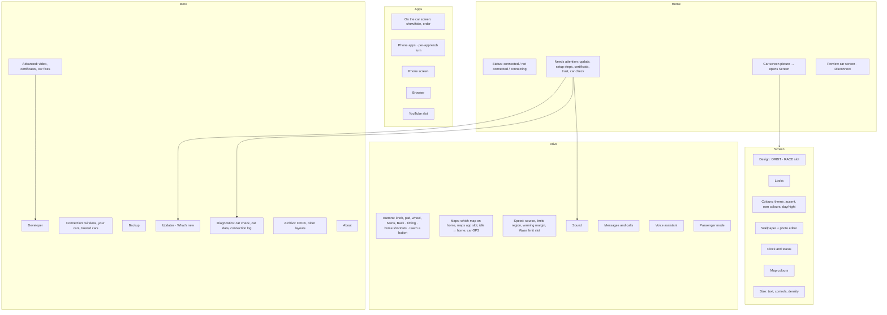

# MyPlay phone app: new information architecture (plan)

Information architect, 2026-11-22. A plan only: no app code is changed. Built from reading the
code on `claude/myplay` (`ui/MainActivity.kt`, `ui/MyPlayUpdateCheck.kt`, `ui/phone/*`,
`Settings.kt`, `SettingsBackup.kt`, `MyPlayBackupKeys.kt` and every file that reads or writes the
`settings` SharedPreferences). Where the code did not settle something, it says **"verify"**.
Visual design is **not** part of this plan; a later session does it.

The owner's verdict on today's app: too much text, things are hard to find (updates sit under
Connection), Back loses the place on the main screen, and they want a new app rather than a patch.

---

## 1. What is wrong today (from the code)

| Problem | Where in the code | Effect |
|---|---|---|
| **Back resets the main screen's scroll.** | `MainActivity.Home()`: the start screen and each page are two branches of one `AnimatedContent(page)`. Opening a page disposes the start screen's `LazyColumn`, and its list state is not hoisted or saved. | Back always lands at the top of a very long screen. |
| **No real back stack.** | `page` is one `rememberSaveable` value. Bar → "Change the layout" sets `page = LAYOUT`; Back then sets `page = null`. | Back from a page opened from another page skips the page you came from. |
| **Updates are split three ways.** | The **Updates** tile opens **About** (`pageOf(BehindTile.UPDATES) = Page.ABOUT`). The auto-check switch and "Check now" are in **Connection** (`ConnectionSettings` › Updates section). The install button is on the start screen under the banner. | You cannot find updates, which is exactly the owner's complaint. |
| **The start screen holds everything.** | `CustomiseScreen`: update banner, install button, certificate banner, status card, "Finish setting up", car picture, hint, 9 part pills, then 14 tiles. | Long scroll; no hierarchy. |
| **The same setting in two or three places.** | See the "Dup" flags in Appendix A (theme, accent, wallpaper, bar side, dark bar, weather, cards, phone screen, maps follow car lights, certificates, notification access). | Unclear which one is "the" setting. A hidden page (`Page.CAR_SCREEN`) is reachable only by tapping the whole car picture. |
| **Too much text.** | 45 strings are over 150 characters; three are over 300 (`cert_hint`, `setup_backup_hint`, `setup_trusted_head_units_hint`). Most rows carry a two-line subtitle; most pages end with one to four `HintLine`s. | Reading instead of doing. |
| **Settings for layouts the car no longer shows by default.** | ORBIT (`ui/car/myplay`) is on by default (`myplay_engine_preview`, N10). A code search finds ORBIT reading only `wallpaper`, the map colour filter, `rail_position` (app frame side), and its own engine settings; the theme, accent, own colours, status icons, clock, bar items, cards and the "map behind" layout settings are read by the older layouts (`CarShell`, `CarModel`, `CarRuntime`). **Verify per setting** before moving any to Archive. | The owner tunes things that may not change the ORBIT screen at all. |
| **Dead code.** | `CategoryRow()` and `Header()` in `MainActivity.kt` are never called; `Page.*.subtitleRes` is only read by `CategoryRow`. | Noise for the rebuild; drop. |

---

## 2. Principles

1. **One home per thing.** Every setting, action and piece of status has exactly one page. Other
   places may show a *shortcut* (a status line that opens it), never a second control.
2. **Where would the owner look?** Group by the owner's task ("change how the car screen
   looks", "change what a button does"), not by how the code is split.
3. **The car first, the phone second, the internals last.** Daily things on top; things done
   once (permissions, certificates) in Setup and Connection; test tools under Developer.
4. **Back always returns to exactly where you were**: same page, same scroll, same open row.
5. **Short words; details on request.** A label and at most one line of help. Anything longer
   goes behind an ⓘ.
6. **Storage never changes.** New pages read and write the same keys, with the same types and
   defaults. Backups keep working unchanged.

---

## 3. The new structure

### 3.1 Top-level categories

Five destinations in a **bottom bar**:

| Tab | Holds | Why it is a tab |
|---|---|---|
| **Home** | Connection status, anything that needs attention (update, setup, certificate, trust), the car screen picture, Preview and Disconnect | The first question is always "is it working, and is anything wrong?" |
| **Screen** | How the car screen **looks**: design (ORBIT), looks, colours, wallpaper, clock and status, map colours, size | The owner spends most time here; the car picture lives here too |
| **Drive** | How the car **behaves** while driving: buttons and knob, maps, speed and limits, sound, messages and calls, voice, passenger mode | Everything that changes what happens in the car, not what it looks like |
| **Apps** | What is **on** the car screen: the app list and order, phone apps (mirrored), phone screen, browser, YouTube | A list of apps is its own task; it will grow (more maps apps, YouTube as an app) |
| **More** | Updates, connection and cars, backup, diagnostics (car check, car data, log), advanced, archive, about | Things done rarely, each one tap away and never buried |

Why a bottom bar rather than a home with cards (today's model):

- Five fixed doors are learned once; the owner always knows which door, and the tab bar shows
  where you are. A home with 14 tiles makes every visit a scan.
- Each tab keeps its own history, so switching from Screen to Drive and back does not lose your
  place in either. This answers the Back complaint at the root.
- A badge on a tab (More, for an update) is a standard, quiet place for "something new".
- It leaves room for new features as **rows inside a tab**, not new top-level tiles.

### 3.2 The map



The same as a tree, with each page's contents (`›` = opens a page; `·` = rows on that page):

```
Home
├─ Status card ............ connected car, how (USB / wireless), last error; Trust (when asked)
├─ Needs attention ........ cards, only when true (see §6); each opens its page
├─ Car screen picture ..... tap a part → that Screen page (pushed on Home's stack)
└─ Preview car screen · Disconnect (when connected)

Screen
├─ Car screen picture (tap a part → its page)
├─ › Design ............... ORBIT (RACE later) · Panels close after · (DECK lives in Archive)
├─ › Looks ................ built-in · yours · save · open file · share
├─ › Colours .............. Theme · Accent · Day and night · Map apps follow car lights
│                            › Your own colours (night / day, per part)
├─ › Wallpaper ............ none / built-in / photo · › Edit photo
├─ › Clock and status ..... clock size, bold, colour · battery icon/number/%/colour by level
│                            · signal · status size · Weather (with privacy line)
├─ › Map colours .......... preset · sliders · before/after
└─ › Size ................. Text size · Control size · How much fits (density)

Drive
├─ › Buttons .............. drawing of wheel + knob → per control: press, hold, double, hold+turn
│                            · Timing (hold, double) · Show what a button did
│                            › Home shortcuts (pad keys on ORBIT home, info-only home)
│                            › Teach a car button (the 4 buttons round the knob) · Reset all
├─ › Maps ................. Map on the home screen · Go home when idle · Use the car's GPS
│                            (+ mock-location check) · [slot: more maps apps]
├─ › Speed ................ Speed source · Speed limits: region, file, download/delete
│                            · Warn when over by · [slot: Waze limit hook]
├─ › Sound ................ Sound to the car · method in use · set up a method
│                            · Play music when connected
├─ › Messages and calls ... Banners · Group chats · Read aloud · Do not disturb (+ access)
│                            · Auto-reply (+ text) · Calls on phone speaker
├─ › Voice assistant ...... same as phone / pick one
└─ Passenger mode (switch, with its warning)

Apps
├─ › On the car screen .... per group: show/hide · › Order
├─ › Phone apps ........... switch · allowed apps · per app: knob turn · keep phone awake
├─ › Phone screen ......... switch · accessibility check
├─ › Browser .............. switch · start page
└─ YouTube (row; today part of Browser; slot for a real YouTube app)
    · Apps that can't run (read-only list, collapsed)

More
├─ › Updates .............. this version · Check now · Check automatically · Install · What's new
├─ › Connection ........... Wireless · Your cars (forget) · Trusted cars (forget)
├─ › Backup ............... Save to file · Load from file · last saved
├─ › Diagnostics .......... › Car check · › Car data (+ "show in the car") · › Connection log
├─ › Advanced ............. Video · Certificates · Car fixes (Bluetooth address, vehicles.json)
│   └─ › Developer ........ Head unit server (+4) · Detailed protocol log · Map areas · Maps text
│                            · Phone parts sample
├─ › Archive .............. DECK · Older layouts (taskbar, dock, app grid, map behind)
└─ › About ................ version · links · thanks · open-source licences · OpenStreetMap notice
```

### 3.3 Routes

One route per page. Names are for the code and for search results; they are not shown.

| Route | Page | Reached from |
|---|---|---|
| `home` | Home | tab |
| `screen` | Screen root | tab; Home picture |
| `screen/design` · `screen/looks` · `screen/colours` · `screen/colours/own` · `screen/wallpaper` · `screen/wallpaper/edit` · `screen/clock-status` · `screen/map-colours` · `screen/size` | Screen pages | Screen root rows; picture parts; search |
| `drive` · `drive/buttons` · `drive/buttons/home-shortcuts` · `drive/buttons/teach` · `drive/maps` · `drive/speed` · `drive/sound` · `drive/messages` · `drive/voice` | Drive pages | Drive root; Home attention cards (sound) |
| `apps` · `apps/car` · `apps/car/order` · `apps/phone-apps` · `apps/phone-screen` · `apps/browser` | Apps pages | Apps root |
| `more` · `more/updates` · `more/whats-new` · `more/connection` · `more/backup` · `more/diagnostics` · `more/diagnostics/car-check` · `more/diagnostics/car-data` · `more/diagnostics/log` · `more/advanced` · `more/advanced/certificates` · `more/advanced/developer` · `more/archive` · `more/archive/deck` · `more/archive/layouts` · `more/about` | More pages | More root; Home attention; notifications |
| `setup` (first run) · `setup/permissions` | Onboarding | first launch; Home "Finish setup" |

Picture parts map to: bar → `screen/clock-status` (or the Archive layout page when an older layout is
on), clock → `screen/clock-status`, status → `screen/clock-status`, cards → Archive layouts (ORBIT has
none; verify), wallpaper → `screen/wallpaper`, apps → `apps/car`, hub → `screen/design`,
speed → `drive/speed`, whole → `screen`.

Notification links: **Trust** → `home` (status card shows the Trust action); **Certificate
expiring / Download certificate** → `more/advanced/certificates`; a future **update** notification →
`more/updates`.

### 3.4 Back and position

- Each tab has its **own back stack**. Back pops within the tab. At a tab's root, Back goes to
  **Home**; at Home, Back leaves the app.
- Switching tabs keeps each tab's stack and position. Tapping the **current** tab again goes to
  its root; tapping it at the root scrolls to the top.
- A page opened from another tab's context (Home picture → Clock and status; Home "Update
  available" → Updates) is **pushed on the current tab's stack**, so Back returns to where you
  tapped.
- **Every page restores its scroll position, open rows and half-filled fields** when you come back
  to it, after rotation, and after the process is killed. (For the builder: hoist each page's list
  state per route and save it, e.g. Navigation Compose with `saveState`/`restoreState`; no page
  may live inside a branch that is disposed when another page opens. After loading a backup,
  re-read settings without resetting the navigation stack.)
- Dialogs and sheets close on Back before the page does.

---

## 4. Where status lives

| Status | Primary home | Shortcut elsewhere |
|---|---|---|
| Connected / not connected / connecting, car name, USB or wireless | Home › Status card | A small dot on the Home tab icon while connected (optional) |
| Video and certificate in use, last error | Home › Status card, one line each, collapsed under "Details" | More › Diagnostics |
| Trust a new head unit | Home › Status card (action) | the notification |
| Update available | More › Updates | Home attention card; badge on **More** |
| Setup missing (permissions, notification access, sound) | Setup page | Home attention card "Finish setup (2 left)" |
| Certificate expiring / expired | More › Advanced › Certificates | Home attention card |
| Car check: result of the last run | More › Diagnostics › Car check | Home attention card only while a run is unfinished or found "nothing arrived" |
| Sound method in use | Drive › Sound | Drive root row value |
| Speed limit file state (region, date, size) | Drive › Speed | Drive root row value |
| Backup last saved | More › Backup | More root row value |

Each root row shows its **current value** on the right (today's tiles already do this; keep the
idea, drop the tile grid). Example: "Sound — Best", "Speed — Lithuania", "Buttons — 2 changed".

## 5. Where updates live

**More › Updates**, one page with everything:

1. This version, and "Up to date" or "Version X is ready".
2. **Install X** (today's `UpdateInstallButton`, with its progress and error lines).
3. **Check now** (today's `MyPlayCheckNow`).
4. **Check automatically** (`check_updates`) with one line: "Once a day, from GitHub."
5. **What's new** (today's release notes dialog, as a page).

Removed: the Updates section from Connection, the update tile that opened About, the second
install button on Home. Home keeps only an attention card that opens this page.

## 6. Advanced, Developer and Archive

**Advanced** (things the owner may need once, each explained in one line):

- **Video**: Highest resolution, Prefer 60 fps, Force H.264, Steady bitrate.
- **Certificates**: list, Import, Download, Update automatically.
- **Car fixes**: Phone's Bluetooth address, Per-car fixes (vehicles.json import / template).

**Developer** (testing tools; a row at the bottom of Advanced):

- Head unit server and its four sub-switches (network, network once, phone screen, this phone).
- Detailed protocol log.
- Show map areas; Log maps text (the Waze check).
- Phone parts sample (today only through an intent extra).

**Archive** (the owner: keep DECK, "move it somewhere like archive"). Everything here works as
today and is stored as today; it is just out of the way:

- **DECK**: a switch "Use DECK instead of ORBIT" (writes `myplay_engine_language` = `deck`), its
  preview note, and the picture. Turning it off returns to ORBIT.
- **Older layouts**: "Use MyPlay's own screen" (`myplay_engine_preview`; off = older layouts), then
  the layout kind (taskbar, dock, app grid, map behind), the map-behind presets and options,
  bar items and side, dark bar, dashboard cards, weather card. Each of these is moved here only
  after a check that ORBIT does not read it (see §1); anything ORBIT does read stays in Screen.
- A short line at the top: "Kept as it was. Not updated any more."

When an archived design or layout is **on**, Home shows one quiet card: "Using DECK — Archive".

## 7. Search

Yes, small and local. A search field at the top of **More** and a search icon in each tab's top
bar. It searches page titles, setting labels and a few synonyms per setting (e.g. "night" →
Colours › Day and night; "police", "Waze" → Drive › Maps and Speed; "AA", "certificate" →
Advanced). A result opens the page scrolled to that row, briefly highlighted, pushed on the
current stack so Back returns to the results. The index is built from the same route table as
navigation, so a new setting is searchable by being added once.

## 8. Slots for future features

| Future feature | Slot | Why it fits without restructuring |
|---|---|---|
| RACE | Screen › Design, a second choice beside ORBIT; hidden while paused | Design is the place for "which car screen" |
| More maps apps | Drive › Maps, a "Maps apps" list (which ones, order, default) | Maps already owns "which map on home" |
| Waze speed limit hook | Drive › Speed › "Limit from Waze" switch, off by default, with "needs the MyPlay module" line | Speed owns every limit source (N20 order) |
| The 4-button teach | Drive › Buttons › Teach a car button; once taught, the 4 buttons appear in the drawing like the knob | Buttons owns every control |
| Speed-limit regions | Drive › Speed › Region list (today one: Lithuania) | Already a list; more rows only |
| YouTube as a real app | Apps › YouTube page (today a row under Browser) | Apps owns every app |
| A future car-side "phone settings" link | More › Connection | Connection owns the car |
| More looks, shared looks | Screen › Looks | Already a list |

---

## 9. Content rules

1. **Labels**: 1–3 words, sentence case, a noun or a verb phrase. "Wireless", "Play music when
   connected", not "Connect wirelessly to bonded head units".
2. **Help**: at most **one line** (about 60 characters) under a row, and only when the label is
   not enough. Longer explanations go behind an **ⓘ** that opens a sheet. No `HintLine` stacks.
3. **Progressive disclosure**: show the common choice; put the rest under "More options" on the
   same page. Sub-switches appear only when their parent is on (today's pattern; keep it).
4. **Same word, same thing**, everywhere:

   | Use | Not |
   |---|---|
   | car screen | head unit display, HU |
   | car | head unit (except in Developer and Certificates) |
   | knob, pad, wheel, Menu, Back | dash knob controller, MMI |
   | maps app | navigation app, map app |
   | phone apps | standalone apps, mirrored apps |
   | look | style, theme bundle |
   | highlight | ring, focus ring |
   | Sound | car audio, audio capture |
   | from the next connection | takes effect on reconnect, applied from the next session |

5. **No jargon outside Advanced/Developer**: no dpi, H.264, bitrate, PEM, adb, Shizuku, MediaProjection in
   labels. Where a method needs one (Sound), name it in the ⓘ sheet.
6. **Values, not sentences**, on the right of a row: "Best", "Off", "2 changed", "Lithuania".
7. **Warnings are one line** in the warning style, with the reason in ⓘ (passenger mode, phone apps,
   developer server).
8. **Every privacy line is kept** (weather position, logs, speed limit file offline), shortened, never removed.

### 9.1 Example rewrites

**A. Backup (today: 3 notes, 680 characters, plus two subtitles)**

Today:
> Save your settings to a file, or load one back. Trusted head units, certificates, custom
> wallpaper photos, phone-specific state and the options that open MyPlay to the network or lift
> a safety check (head unit server, passenger mode, root audio…) are left out: …
> Loading restores every setting in the file, including ones that use the internet: the update
> check, the weather and the browser's address. If they were on when the file was saved, they are
> on again.
> A wallpaper photo is not in the file. After loading, choose the photo again on the Wallpaper page.

New:
> **Save to file** — Last saved 3 Nov
> **Load from file** — Replaces your settings
> ⓘ *What's not in the file* → sheet: "Photos, certificates, trusted cars and safety switches
> (passenger mode, developer tools). Set those again on this phone."

**B. ORBIT switch and its settings (today: `phone_orbit_preview_hint`, 264 characters, + 3 hints)**

Today:
> The car screen MyPlay draws itself: the home and every world (navigate, music, calls, apps, car,
> settings). On by default. Off: the car uses an older layout chosen below (taskbar, dock, classic,
> map behind); those will be removed later. The picture above shows …

New (Screen › Design):
> **Design** — ORBIT
> **Panels close after** — 5 s
> (the on/off switch moves to Archive › Older layouts, as "Use MyPlay's own screen")

**C. Trusted head units (today: `setup_trusted_head_units_hint`, 331 characters)**

Today:
> A paired wireless car is trusted on its first connection; a new USB or developer head unit only
> after you tap Trust (in its notification or on the home screen). Only trust a head unit you are
> connected to right now. If a head unit shows a different certificate …

New (More › Connection):
> **Trusted cars**
> Audi MMI — Forget
> ⓘ → "A new car asks once. Tap Trust only for the car you're in."

**D. Calls on the phone speaker (today: 221 characters)**

> Today: "While connected to a car, calls use the phone's loudspeaker and microphone instead of
> the car's hands-free link. For wireless adapters or head units whose microphone doesn't work.
> Takes effect from the next connection."
>
> New: **Calls on phone speaker** — "If the car's microphone doesn't work." (from the next connection is shown as a small tag)

---

## 10. States

| State | Home shows | Elsewhere |
|---|---|---|
| **First run** (fresh install) | A short **Setup** flow instead of Home: 1. Permissions (one button, grouped by reason: calls, location, Bluetooth/Wi-Fi, microphone, notifications), 2. Notification access, 3. Sound (pick the best available method), 4. "Connect to the car" (USB or wireless, one line each). Each step can be skipped. No "What's new" on a fresh install (today's rule; keep). | — |
| **Not connected** | Status card: "Not connected" + one line "Plug in USB or start the car." Preview button stays. | Car check, Car data: "Connect first" with nothing else on the page |
| **Connecting / waiting** | "Connecting to <car>…" | — |
| **Connected** | Car name, USB/wireless, Disconnect; Details (video, certificate) collapsed | Car data live; Car check enabled |
| **Trust needed** | Status card: "New car — Trust?" with fingerprint in ⓘ | Notification |
| **Update available** | Attention card "MyPlay X is ready" → Updates | Badge on More; Updates page shows Install |
| **Installing / failed install** | — | Updates page: progress, then one-line error (today's `phone_update_fail_*`, shortened) |
| **Permissions missing** | Attention card "Finish setup (N left)" → Setup | Each feature that needs a missing permission shows a one-line inline "Allow …" row at its top (Messages: notification access; Do not disturb: policy access; Car GPS: mock location; Phone screen: accessibility; Install: unknown apps) |
| **Permission refused for good** | Same card; its action opens MyPlay's system settings (today's `permissionBlocked` logic; keep) | — |
| **Certificate expiring / expired** | Attention card (error tone) → Certificates | Notification |
| **Error on last connection** | One line in the status card, ⓘ for the full text | Connection log |
| **Download errors** (certificate, speed limits, update) | — | One line on the page that started it |
| **Archived design in use** | Quiet card "Using DECK" → Archive | — |

Attention cards appear **only when true**, in this order: trust, certificate expired, setup,
update, certificate expiring, unfinished car check. At most three; the rest under "N more".

---

## 11. Migration: every stored key and its new home

Rules for the builder:

- **No key is renamed, retyped or given a new default.** New pages call the same `Settings`
  getters and setters (or the same extension properties in the `MyPlay*Settings` files).
- `SettingsBackup.ALLOWED`, `SettingsBackup.BLOCKED` and `MyPlayBackupKeys.ALLOWED` are **not
  changed** by the rebuild; a test should assert the three sets are unchanged.
- Legacy keys still read as fallbacks (`rail_right`, `car_style`, `dashboard_media_first`,
  `show_calendar`) stay readable and stay in the backup list.
- The `MyPlayLooks.KEYS` set is unchanged; Looks keeps writing those keys.
- After loading a backup, every page re-reads settings (today: `settingsGeneration`); the new app
  must do the same **without** resetting the navigation stack.

SharedPreferences file `settings` unless noted. "Backup": A = allowed, B = blocked, — = neither.

| Key | Type | Backup | New home |
|---|---|---|---|
| `hu_server` | Boolean | B | More › Advanced › Developer |
| `hu_server_lan` | Boolean | B | Developer |
| `hu_server_lan_once` | Boolean | B | Developer |
| `head_unit_server_mirror` | Boolean | B | Developer |
| `hu_server_localhost` | Boolean | B | Developer |
| `verbose_protocol_log` | Boolean | A | More › Diagnostics › Connection log (also listed in Developer) |
| `log_car_input` | Boolean | A | More › Diagnostics › Connection log |
| `myplay_maps_follow_car_lights` | Boolean | A | Screen › Colours › Day and night |
| `wireless` | Boolean | A | More › Connection |
| `check_updates` | Boolean | A | More › Updates |
| `update_latest_version`, `update_latest_url`, `update_last_check_ms`, `update_dismissed_version` | String/Long | — | internal; read by More › Updates and the Home card |
| `max_video_height` | Int | A | More › Advanced › Video |
| `prefer_60fps` | Boolean | A | Advanced › Video |
| `force_h264` | Boolean | A | Advanced › Video |
| `constant_bitrate_video` | Boolean | A | Advanced › Video |
| `car_density` | Int | A | Screen › Size |
| `calls_on_phone_speaker` | Boolean | A | Drive › Messages and calls |
| `rail_position` | String | A | Screen › Clock and status ("Bar side"), if ORBIT's frame reads it (verify: `MyPlayAppFrame` uses `railOnRight`); else Archive › Older layouts |
| `rail_right` (legacy) | Boolean | A | none (fallback for `rail_position`) |
| `style_theme` | String | A | Screen › Colours › Theme (verify ORBIT; else Archive) |
| `style_layout` | String | A | Archive › Older layouts |
| `car_style` (legacy) | String | A | none (fallback for theme and layout) |
| `style_accent` | String | A | Screen › Colours › Accent (verify ORBIT; else Archive) |
| `car_text_size` | String | A | Screen › Size (verify ORBIT) |
| `car_control_size` | String | A | Screen › Size (verify ORBIT) |
| `ignore_driving` | Boolean | B | Drive › Passenger mode |
| `show_weather` | Boolean | A | Screen › Clock and status › Weather |
| `wallpaper` | String | A | Screen › Wallpaper |
| `dark_bar` | Boolean | A | Archive › Older layouts (verify ORBIT) |
| `dashboard_cards` | String | A | Archive › Older layouts › Cards |
| `dashboard_media_first`, `show_calendar` (legacy) | Boolean | A | none (fallbacks for `dashboard_cards`) |
| `car_theme` | String | A | Screen › Colours › Day and night |
| `car_audio` | Boolean | A | Drive › Sound |
| `phone_bt_address` | String | — | More › Advanced › Car fixes |
| `root_audio` | Boolean | B | Drive › Sound (set by the root check, not a switch) |
| `assistant_pkg` | String? | A | Drive › Voice assistant |
| `phone_screen` | Boolean | A | Apps › Phone screen |
| `standalone_apps` | Boolean | B | Apps › Phone apps |
| `standalone_keep_screen_awake` | Boolean | A | Apps › Phone apps |
| `standalone_app_pkgs` | StringSet | A | Apps › Phone apps |
| `browser` | Boolean | A | Apps › Browser |
| `browser_url` | String | A | Apps › Browser |
| `car_data_app` | Boolean | A | More › Diagnostics › Car data |
| `call_bar_x`, `call_bar_y` | Float | A | internal (set by dragging on the car) |
| `car_gps` | Boolean | A | Drive › Maps |
| `resume_media` | Boolean | A | Drive › Sound |
| `message_banners` | Boolean | A | Drive › Messages and calls |
| `group_messages` | Boolean | A | Drive › Messages and calls |
| `dnd_driving` | Boolean | A | Drive › Messages and calls |
| `auto_reply` | Boolean | A | Drive › Messages and calls |
| `auto_reply_text` | String | A | Drive › Messages and calls |
| `read_messages` | Boolean | A | Drive › Messages and calls |
| `known_cars` | StringSet | — | More › Connection › Your cars |
| `last_nav`, `last_media` | String | A | internal |
| `rail_widgets` | String | A | Screen › Clock and status (verify ORBIT; else Archive) |
| `app_order` | String | A | Apps › On the car screen › Order |
| `requested_permissions` | StringSet | — | internal (Setup) |
| `hidden_apps` | StringSet | A | Apps › On the car screen |
| `car_keys_seen` | StringSet | — | internal; **no UI today** |
| `car_key_map` | StringSet | — | **no UI today**, still read by `CarSession`; superseded by `myplay_buttons`; keep, no page |
| `instance_id` | String | — | internal |
| `cert_auto_update` | Boolean | B | More › Advanced › Certificates |
| `cert_update_last_check_ms`, `cert_expiry_notified`, `cert_expiry_dismissed`, `cert_index` | Long/String/Int | — | internal (Certificates; Home card) |
| `myplay_mirror_turns` | String | A | Apps › Phone apps (per app) |
| `myplay_gesture_line` | Boolean | A | Drive › Buttons |
| `myplay_speed_source` | String | A | Drive › Speed |
| `myplay_engine_preview` | Boolean | A | Archive › Older layouts ("Use MyPlay's own screen") |
| `myplay_engine_language` | String | A | Screen › Design (ORBIT, RACE later); `deck` set from Archive › DECK |
| `myplay_maps_idle_home` | Int | A | Drive › Maps |
| `myplay_learned_buttons` | String | A | Drive › Buttons › Teach |
| `myplay_learn_button`, `myplay_learn_button_at` | String/Long | — | internal (Teach, while waiting) |
| `myplay_info_home` | Boolean | A | Drive › Buttons › Home shortcuts |
| `myplay_home_pad` | String | A | Drive › Buttons › Home shortcuts |
| `myplay_panel_timeout` | Int | A | Screen › Design |
| `myplay_speed_limit_margin` | Int | A | Drive › Speed |
| `myplay_speed_limit_region` | String | A | Drive › Speed |
| `myplay_speed_limit_checked` | Long | — | internal (Speed) |
| `myplay_map_filter` | String | A | Screen › Map colours |
| `myplay_layout_spec`, `myplay_layout_preset` | String | A | Archive › Older layouts › Map behind |
| `myplay_status_battery_icon`, `_battery_number`, `_percent_sign`, `_size`, `_color`, `_color_by_level`, `_signal` | Boolean/String/Int | A | Screen › Clock and status (verify ORBIT) |
| `myplay_clock_size`, `myplay_clock_bold`, `myplay_clock_color` | String/Boolean/Int | A | Screen › Clock and status (verify ORBIT) |
| `myplay_home_maps` | String | A | Drive › Maps |
| `myplay_gesture_hold_ms`, `myplay_gesture_double_ms` | Long | A | Drive › Buttons › Timing |
| `myplay_buttons` | String | A | Drive › Buttons |
| `myplay_button_codes` | String | A | internal; **no writer found in the phone app** (verify on the car side) |
| `myplay_look_colours` | String | A | Screen › Colours › Your own colours |
| `myplay_looks` | String | A | Screen › Looks |
| `myplay_backup_last_saved` | Long | — | More › Backup |
| `myplay_whats_new_seen` | String | — | internal (Updates / What's new) |
| `myplay_wallpaper_edit` | String | — | Screen › Wallpaper › Edit photo (not backed up, like the photo) |
| `myplay_debug_map_areas` | Boolean | — | Developer |
| `myplay_debug_nav_text` | Boolean | — | Developer |
| `myplay_orbit_default_done` | Boolean | — | internal (one-time migration) |
| file `driving_mode` › `previous_interruption_filter` | Int | — | internal (Do not disturb restore) |
| file `head_unit_pins` › one key per car | StringSet | — | More › Connection › Trusted cars |
| `filesDir/wallpaper.jpg` | file | — | Screen › Wallpaper |
| `vehicles.json` | file | — | Advanced › Car fixes |
| `filesDir/speed_limits/<region>.bin/.json` | files | — | Drive › Speed |
| certificate store (`CertificateStore`) | files | — | Advanced › Certificates |
| connection log (`DiagLog`, in memory) | — | — | Diagnostics › Connection log |

---

## 12. Open questions for the owner

1. **Bottom bar with five tabs (Home, Screen, Drive, Apps, More), or one home page with big
   cards?** *Recommended: the bottom bar.* It keeps your place in each part and makes Back
   predictable.
2. **Settings that ORBIT does not use (older layouts, bar items, cards, possibly theme and status
   icons): move them all to Archive?** *Recommended: yes*, after a check of each one; anything
   ORBIT reads stays in Screen.
3. **Check for updates automatically?** Today it is off, so updates show only after "Check now".
   *Recommended: on* (one request to GitHub a day), with the switch on the Updates page.
4. **Car screen picture: on Home, on Screen, or both?** *Recommended: both* — small on Home
   (tap opens Screen), large at the top of Screen with tappable parts.
5. **Developer tools: always visible at the bottom of Advanced, or hidden until unlocked (tap the
   version 7 times)?** *Recommended: visible at the bottom of Advanced*; you use them for the Waze
   checks.

---

## Appendix A. Inventory of today's phone app

Flags: **Dup** = also elsewhere; **Mis** = in the wrong place; **Dead** = unused or unreachable;
**Legacy** = for older layouts or DECK; **Dev** = testing only.

### A.1 Pages and how they are reached

| Page (code) | Reached from | Contents (short) | Flags |
|---|---|---|---|
| Start screen (`CustomiseScreen` in `Home()`) | launch | update banner, install button, certificate banner, status card, Finish setting up, car picture, hint, 9 part pills, "Behind the scenes" 14 tiles | Back loses scroll |
| Car screen (`Page.CAR_SCREEN`, `CarScreenSettings`) | only by tapping the **whole** car picture | theme+layout+accent, day/night, maps follow car lights, bar side, dark bar, wallpaper, weather, dashboard cards, passenger mode, phone screen + touch check | **Dup** of Colours, Bar, Wallpaper, Cards, Apps; hard to find |
| Apps (`AppsCard`) | tile Apps; picture part apps | app list by group with show/hide; built-ins (Phone, Notifications, Phone screen, Browser, YouTube); browser URL; App order; Phone apps (standalone) with per-app knob turn; unsupported apps; allow-list hint | Phone screen **Dup** |
| Voice (`AssistantCard`) | tile Voice | same as phone / pick assistant | — |
| Messages (`MessageSettings`) | tile Messages | notification access check, banners, groups, read aloud; while driving: DND (+ access check), auto-reply (+ text) | access check **Dup** of start screen |
| Sound (`AudioSettings`) | tile Sound; Finish setting up | Sound to car switch; method in use; three methods with set-up actions | — |
| Connection (`ConnectionSettings`) | tile Connection | wireless, resume music, calls on speaker, BT address; **Updates** (auto check, Check now); car GPS (+ mock location); video (60 fps, max resolution, H.264, constant bitrate); your cars; trusted head units | Updates **Mis**; video, BT address belong in Advanced; resume music, calls belong in Drive |
| Car data (`CarDataCard`) | tile Car data | "show in the car" switch; car identity; live sensor values | — |
| Advanced (`Page.ADVANCED`) | tile Advanced | head unit server (5 switches), certificates, vehicles.json, map areas, maps text, connection log (2 switches, last 40 lines, copy/save/clear) | certificates **Dup** |
| Certificates (`Page.CERTIFICATES`) | tile Certificates | same card as in Advanced | **Dup** |
| Bar (`BarPage`) | pill Bar; picture part bar | layout in use + Change, side, bar items order, dark bar, weather, clock-card notes, map-behind bar | dark bar, weather **Dup**; mostly **Legacy** (verify) |
| Cards (`CardsPage`) | pill Cards; picture part cards | layout note, dashboard cards order, weather card note, maps on home | maps on home **Mis** (belongs in Maps); **Legacy** |
| Wallpaper (`WallpaperPage` + `WallpaperEditorDialog`) | pill Wallpaper; picture part | none / gradients / photo; edit photo (crop, dim, blur) | **Dup** of Car screen |
| Colours (`ColoursPage` + `MapColoursSection`) | pill Colours | theme, accent, phone accent, own colours (night/day per role), day/night, maps follow car lights, map colour filter | theme/accent/day-night **Dup** |
| Looks (`LooksPage`) | pill Looks | built-in looks, your looks, save, open file, share, delete | — |
| Layout (`LayoutScreen`) | pill Layout; picture part hub; Bar/Cards "Change" | ORBIT switch + language (ORBIT/DECK) + panel timeout + maps idle home; layout kind; map-behind presets and options | DECK, layout kind **Legacy**; ORBIT switch hint very long |
| Size (`SizePage`) | pill Size | text size, control size, density | — |
| Clock (`ClockPage`) | pill Clock; picture part | size, bold, colour | — |
| Status (`StatusIconsPage`) | pill Status; picture part | battery icon/number/sign, signal, size, colour, colour by level | — |
| Speed (`SpeedLimitPage` + `SpeedSourceChoice`) | tile Speed; picture part speed | speed source; region; file (download, look for newer, delete); margin; notes | OSM notice **Dup** in About |
| Buttons (`ButtonsScreen` + `HomePadSection` + `TeachButtonSection`) | tile Buttons | controls drawing; per control gestures → action; timing sliders; home pad shortcuts; info-only home; teach a button; show what a button did; reset | — |
| Car check (`CarCheckPage`) | tile Car check | 14 steps, step by step; record what arrived; share log | — |
| Backup (`BackupPage`) | tile Backup | save, load (with confirm), three notes | text-heavy |
| About (`Page.ABOUT`, `AboutScreen`) | tiles About **and Updates** | OSM notice, What's new, what MyPlay is, links, thanks, open-source list, licence line | Updates tile **Mis** |
| What's new (`WhatsNewDialog`) | once after an update; About | release notes | — |
| Preview (`CarPreviewActivity`) | status card "Preview car screen" | the car screen drawn on the phone | — |
| Phone parts sample (`PhonePartsSample`) | intent extra `phone_parts` only | every shared phone part | **Dev** |
| `CategoryRow`, `Header` | never called | — | **Dead** |

### A.2 Settings shown today (key, type, default, where)

Defaults as the getters read them.

| Key | Type | Default | Shown today on | Flags |
|---|---|---|---|---|
| `wireless` | Boolean | true | Connection | |
| `resume_media` | Boolean | false | Connection | Mis |
| `calls_on_phone_speaker` | Boolean | false | Connection | Mis |
| `phone_bt_address` | String | "" | Connection (text field) | Mis |
| `check_updates` | Boolean | false | Connection › Updates | Mis |
| `car_gps` | Boolean | true | Connection › Location | |
| `prefer_60fps` | Boolean | true | Connection › Video | Mis |
| `max_video_height` | Int | 1080 (choices 480–1440) | Connection › Video | Mis |
| `force_h264` | Boolean | false | Connection › Video | Mis |
| `constant_bitrate_video` | Boolean | false | Connection › Video | Mis |
| `known_cars` | StringSet | empty | Connection › Your cars (forget) | |
| `head_unit_pins` file | StringSet per car | empty | Connection › Trusted head units (forget) | |
| `hu_server` | Boolean | false | Advanced | Dev |
| `hu_server_lan` | Boolean | false | Advanced (when server on) | Dev |
| `hu_server_lan_once` | Boolean | true | Advanced (when server on) | Dev |
| `head_unit_server_mirror` | Boolean | false | Advanced (when server on) | Dev |
| `hu_server_localhost` | Boolean | false | Advanced (when server on) | Dev |
| `cert_auto_update` | Boolean | false | Advanced; Certificates | Dup |
| `myplay_debug_map_areas` | Boolean | false | Advanced | Dev |
| `myplay_debug_nav_text` | Boolean | false | Advanced | Dev |
| `verbose_protocol_log` | Boolean | false | Advanced › Log | |
| `log_car_input` | Boolean | true | Advanced › Log | |
| `message_banners` | Boolean | true | Messages | |
| `group_messages` | Boolean | true | Messages | |
| `read_messages` | Boolean | false | Messages | |
| `dnd_driving` | Boolean | false | Messages › While driving | |
| `auto_reply` | Boolean | false | Messages › While driving | |
| `auto_reply_text` | String | phone-language default (not stored) | Messages (when auto-reply on) | |
| `assistant_pkg` | String? | null (phone's default) | Voice | |
| `car_audio` | Boolean | true | Sound | |
| `root_audio` | Boolean | false | Sound (set when su is granted) | |
| `hidden_apps` | StringSet | empty | Apps (per app, built-ins by id) | |
| `app_order` | String | empty | Apps › App order | |
| `phone_screen` | Boolean | false | Apps; Car screen | Dup |
| `browser` | Boolean | false | Apps | |
| `browser_url` | String | `https://duckduckgo.com/` | Apps (when browser on) | |
| `standalone_apps` | Boolean | false | Apps › Phone apps | |
| `standalone_keep_screen_awake` | Boolean | false | Apps › Phone apps | |
| `standalone_app_pkgs` | StringSet | empty | Apps › Phone apps | |
| `myplay_mirror_turns` | String | "" | Apps › Phone apps (per app) | |
| `car_data_app` | Boolean | false | Car data | |
| `style_theme` | String | `aare` (or `carplay` from legacy) | Car screen; Colours | Dup |
| `style_layout` | String | `taskbar` (or `dock` from legacy) | Car screen; Layout; Bar/Cards via Change | Dup, Legacy |
| `style_accent` | String | `theme` | Car screen; Colours | Dup |
| `car_theme` | String | `dark` | Car screen; Colours | Dup |
| `myplay_maps_follow_car_lights` | Boolean | true | Car screen; Colours | Dup |
| `rail_position` | String | `auto` | Car screen; Bar | Dup |
| `dark_bar` | Boolean | false | Car screen; Bar | Dup, Legacy? |
| `wallpaper` | String | `none` | Car screen; Wallpaper | Dup |
| `myplay_wallpaper_edit` | String | no edit | Wallpaper › Edit photo | |
| `show_weather` | Boolean | false | Car screen; Bar | Dup |
| `dashboard_cards` | String | map, media, calendar, notification | Car screen; Cards | Dup, Legacy |
| `ignore_driving` | Boolean | false | Car screen › Driving | |
| `rail_widgets` | String | clock, battery, weather | Bar | Legacy? |
| `myplay_home_maps` | String | `last` | Cards | Mis |
| `myplay_look_colours` | String | "" | Colours › Your own colours | |
| `myplay_map_filter` | String | none (identity) | Colours › Map colours | |
| `myplay_looks` | String | none saved | Looks | |
| `myplay_engine_preview` | Boolean | true | Layout ("MyPlay's own screen") | Legacy (off = old layouts) |
| `myplay_engine_language` | String | `orbit` | Layout (ORBIT / DECK) | DECK Legacy |
| `myplay_panel_timeout` | Int | 5 s (3, 5, 8, 15, never) | Layout | |
| `myplay_maps_idle_home` | Int | 0 = off (1, 2, 5, 10 min) | Layout | Mis |
| `myplay_layout_preset` | String | `D` | Layout (map behind) | Legacy |
| `myplay_layout_spec` | String | preset D | Layout; Bar; Cards (map behind) | Legacy |
| `car_text_size` | String | `default` | Size | |
| `car_control_size` | String | `default` | Size | |
| `car_density` | Int | 0 = Auto | Size | |
| `myplay_clock_size` | String | normal | Clock | |
| `myplay_clock_bold` | Boolean | false | Clock | |
| `myplay_clock_color` | Int? | unset (follows look) | Clock | |
| `myplay_status_battery_icon` | Boolean | true | Status | |
| `myplay_status_battery_number` | Boolean | true | Status | |
| `myplay_status_percent_sign` | Boolean | false | Status | |
| `myplay_status_size` | String | normal | Status | |
| `myplay_status_color` | Int? | unset (follows look) | Status | |
| `myplay_status_color_by_level` | Boolean | false | Status | |
| `myplay_status_signal` | Boolean | true | Status | |
| `myplay_speed_source` | String | `auto` | Speed | |
| `myplay_speed_limit_region` | String | "" (none; only Lithuania today) | Speed | |
| `myplay_speed_limit_margin` | Int | 9 km/h | Speed | |
| `myplay_buttons` | String | "" (defaults) | Buttons | |
| `myplay_gesture_hold_ms` | Long | 600 (300–2000) | Buttons › Timing | |
| `myplay_gesture_double_ms` | Long | 250 (150–600) | Buttons › Timing | |
| `myplay_gesture_line` | Boolean | true | Buttons | |
| `myplay_home_pad` | String | `HomePad.DEFAULT` | Buttons › Home pad | |
| `myplay_info_home` | Boolean | false | Buttons › Home pad | |
| `myplay_learned_buttons` | String | "" | Buttons › Teach | |
| `myplay_learn_button` (+`_at`) | String/Long | none | Buttons › Teach (while waiting) | |
| `car_key_map`, `car_keys_seen` | StringSet | empty | **nowhere** (car reads `car_key_map`) | Dead UI |
| `myplay_button_codes` | String | "" | **nowhere** | Dead? (verify) |

Not shown anywhere (internal state): `update_*`, `cert_update_last_check_ms`, `cert_expiry_*`,
`cert_index`, `instance_id`, `requested_permissions`, `last_nav`, `last_media`, `call_bar_x/y`,
`myplay_backup_last_saved` (shown as a value only), `myplay_whats_new_seen`,
`myplay_speed_limit_checked`, `myplay_orbit_default_done`, legacy `rail_right`, `car_style`,
`dashboard_media_first`, `show_calendar`, and `driving_mode` › `previous_interruption_filter`.

**Backup gaps found**: none that lose a setting. `myplay_wallpaper_edit` is not in the backup, which
matches the photo not being in it. `phone_bt_address` and `known_cars` are left out on purpose
(phone-specific).

### A.3 Actions and buttons

| Action | Where today | Does | Flags |
|---|---|---|---|
| Preview car screen | status card | opens `CarPreviewActivity` | |
| Disconnect | status card (connected) | `ProjectionService.stop` | |
| Trust (fingerprint) | status card; notification | `ProjectionService.trust` | |
| Update banner tap / dismiss | start screen | opens release page / `UpdateChecker.dismiss` | |
| Download and install | start screen; Connection › Check now result | `UpdateInstallButton` | Dup |
| Check now | Connection › Updates | `UpdateChecker.fetchLatest` | Mis |
| Certificate banner tap / dismiss | start screen | `ACTION_DOWNLOAD_CERT` / `CertificateUpdates.dismiss` | |
| Set up permissions | Finish setting up | runtime permission request, or app details when refused for good | |
| Notification access | Finish setting up; Messages | opens listener settings | Dup |
| Sound set-up rows | Sound | README link; Shizuku permission / root check / Shizuku download; screen-capture consent | |
| Mock location | Connection (car GPS on) | opens developer options | |
| DND access | Messages (DND on) | opens policy access settings | |
| Phone screen touch | Car screen (phone screen on) | opens accessibility settings | |
| Forget car / Forget head unit | Connection | `forgetCar` / `PinnedHeadUnits.forget` | |
| Import / Download / Remove certificate; PKCS#12 password | Certificates | `CertificateStore` / `CertificateDownload` | |
| vehicles.json Import / Template | Advanced | writes `VehicleOverrides.file` | |
| Log Copy / Save / Clear | Advanced › Log | clipboard / file / `DiagLog.clear` | |
| App show/hide, Up/Down | Apps | `hidden_apps`, `app_order` | |
| Pick photo, Edit photo | Wallpaper; Car screen | saves `wallpaper.jpg`, edit | Dup |
| Colour picker | Colours (own colours, map tint) | | |
| Look: choose, save, open file, share, delete | Looks | | |
| Layout preset A–F, card drag slots | Layout | | Legacy |
| Speed file: Download, Look for newer, Delete | Speed | | |
| Teach it / Cancel / Forget | Buttons › Teach | | |
| Reset to the defaults | Buttons | | |
| Car check: Next, Nothing happened, Again, Share the log | Car check | `ACTION_SEND` | |
| Backup Save / Load (confirm) | Backup | SAF files | |
| What's new | About; once after update | | |
| Links: repository, issues, upstream, thanks handles, open-source components | About | browser | |

### A.4 Status and information shown

Connection status, transport, video, certificate in use, last error, pending trust (status card);
update available; certificate expiring/expired; setup checklist; tile values (version, connected
or waiting, app count, buttons changed, speed region, sound method, messages on/off, voice app,
certificate name, last backup, advanced on/off); sound method in use; live car data (identity,
head unit, connection, video, advertised sensors, ~22 live values); last 40 log lines; speed file
size and date; certificate list with expiry; unsupported apps with reasons; release notes; about
text, thanks, licences.

### A.5 Diagnostics

Car check (14 steps, shareable redacted log); Car data (live sensors; optional car-screen app);
connection log (detailed protocol trace, car input logging, copy/save/clear); map areas overlay;
maps text logging (Waze check); head unit server (DHU, openauto, Headunit Revived, browser
bridges); vehicles.json overrides; phone parts sample.

### A.6 External links, permissions and system screens

- Links: MyPlay's GitHub releases (update check, install, and the `speed-limits` release for
  speed-limit files), README `#car-audio`, Shizuku
  download page, certificate download source, Open-Meteo (weather, through the car), project
  repository, issues, upstream AARE, contributors' profiles, open-source component pages.
- Runtime permissions requested together: microphone, coarse + fine location, Bluetooth connect +
  scan (12+), notifications + nearby Wi-Fi (13+), local network (newest Android), calls (call, answer,
  call log), contacts, phone state, calendar.
- Special access opened in system settings: notification listener, Do Not Disturb policy,
  accessibility (phone screen touches), mock location app (developer options), install unknown apps
  (update install), screen capture consent (sound / phone screen), Shizuku permission, root (su).

### A.7 Where the phone app talks to the car

- **Shared settings**: the car side listens to the same `settings` file and applies most changes at
  once (buttons, gestures, layout, status, engine settings); video and density apply from the next
  connection.
- **`ProjectionService`**: start idle, probe USB and wireless, stop, trust, download certificate,
  give audio consent, the state flow (connected, status, transport, video, certificate, last error,
  pending trust, audio capture).
- **`CarInputEvents`** (car check) and **`CarData.state`** (car data).
- **`DiagLog`** (connection log) and `SessionAapLog.verbose`.
- **Teach a button**: `myplay_learn_button` tells the car to learn the next unknown key.
- **`CarPreviewActivity`** and the car picture draw the car's own UI code with the phone's settings.
- The car side also has its own settings screen (`ui/car/CarSettingsScreen.kt`, ORBIT's
  `EngineSettings.kt`) writing some of the same keys (day/night, home maps, speed source and margin,
  panel timeout, maps idle, info home, gesture line, banners, read aloud, sound, passenger mode).
  The phone must re-read on change (today: `rememberSettingsChanges`, keep it).
